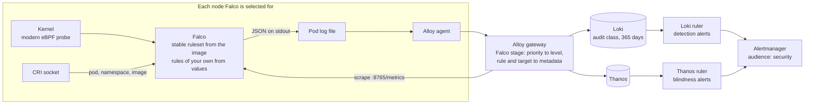

# Runtime security with Falco



This doc proposes adding [Falco](https://falco.org/), the CNCF runtime security project, to `materialize-monitoring` as an optional component.
Falco watches the system calls on the nodes it runs on and reports activity that matches a rule, such as a shell spawned in a container or a binary written and then executed.
No Deployment-team issue tracks this yet.
It answers the platform half of the Security team's runtime-detection item, [SEC-671](https://linear.app/materializeinc/issue/SEC-671), which proposes Falco and leaves Falco the workload to the team that runs the cluster.
In this doc, "you" is a contributor to this repository or an agent working for one.

The central claim is that **Falco's detections travel paths the stack already has.**
A detection is a JSON log line on Falco's standard output, which the Alloy agent already tails and the gateway already routes to Loki.
Falco's health is a Prometheus endpoint, which the gateway already scrapes through a `ServiceMonitor`.
An alert on either is a rule on the rulers the stack already runs, through the Alertmanager it already runs.
What's new is the privileged DaemonSet itself, a gateway stage that understands Falco's priorities, a NetworkPolicy, and the rules.

The following decisions shape everything else, so the doc settles them first:

Performance
: Falco's largest cost lands inside Materialize's own system calls, where Falco's metrics don't show it. Falco isn't recommended for Materialize's nodes until that cost is measured on Materialize's metrics. See [Performance impact on Materialize](#performance-impact-on-materialize).

Where Falco runs
: Falco runs on the node pools a `nodeSelector` picks, by a trust-class label. Materialize's untrusted workloads run on pools Falco watches, and its trusted workloads run on pools where Falco is off and costs nothing. See [Trust classes](#trust-classes).

Where detections live
: Detections are audit records. They go to the `audit` log class, which no tenant can read, and they're kept for 365 days rather than the 30 days operational logs get. See [Detections are audit records](#detections-are-audit-records).

Who is notified
: Detection alerts carry `audience: security`, which is planned separately. This design consumes it.

<!--
Agent note: this doc records decisions and their why. When a decision lands in code, update the section and
check the matching row in "Chart-side prerequisites".

Seven claims here are load-bearing and easy to soften by accident:
  1. Falco is off by default everywhere: in no tag group, `default` included, and off in the Terraform module and the
     per-cloud wrappers. It's a privileged DaemonSet that loads an eBPF program into every node's kernel, and it must
     never arrive in an upgrade.
  2. Nothing in the Falco pod downloads anything, at start or later. The ruleset and the container plugin come from the
     pinned image, which was checked for Falco 0.45.1 on 2026-10-27. A hardened or mirrored image that drops either
     breaks this claim, so check before adding a registry profile.
  3. The chart owns Falco the workload and never the detection logic. Rules of an operator's own arrive through values.
     The chart ships exceptions only for its own components, each with the calibration that justified it.
  4. Detection only. Nothing in the chart acts on a workload in response to a detection. Monitoring that takes down
     the thing it monitors is worse than monitoring that is late, which is the same reasoning as the
     `preemptionPolicy: Never` on the priority classes.
  5. Performance is measured on Materialize's own metrics, not Falco's. The probe's time is spent on clusterd's
     threads, inside clusterd's system calls, so Falco's CPU and memory never show it. The operator page doesn't
     recommend Falco on Materialize's nodes until the A/B measurement in "Testing" exists. Shaped by the author,
     2026-11-02.
  6. Detections are audit records: the `audit` log class, 365 days. The author leans this way (2026-11-02) and
     considered a `security` class instead; the open question records it. The `security` audience is planned
     outside this doc, so don't redesign it here.
  7. Enablement is per node pool, by a nodeSelector on a trust-class label: Falco on untrusted pools, off on trusted
     ones. Recommended by the author, 2026-11-02. Selection is by label and never by taints, so Falco keeps tolerating
     every NoSchedule taint. The replica-size `selectors` and the operator's per-component `nodeSelector` were read
     from MaterializeInc/materialize (src/controller/src/clusters.rs, misc/helm-charts/operator/values.yaml) on
     2026-11-02; the Materialize CR had no node selector then.

Falco's overhead mechanics (the tracepoints fire for every system call, the in-kernel filter to the rules' syscall set,
the single-threaded event loop, the buffer presets) come from falco.org's tuning, performance, dropping and metrics pages
and the adaptive-syscalls blog post, read 2026-11-02. Falco publishes no workload benchmark. The per-invocation times
quoted are sample snapshots with no workload stated; don't present them as a measurement.

The gateway finding in "What exists today" (every Falco line lands at level UNKNOWN, in the droppable bucket) was read
from packages/alloy-pipelines/gateway.yaml on 2026-10-27, not observed live. Re-check it against the pipeline before
citing it again.

SEC-671 is an internal Security-team item. Cite its ownership split, and nothing else from it: this page is public.
-->

## Goals

The goals come from the following stakeholders:

- **Operators of self-managed Materialize** who want runtime threat detection on the nodes their deployment runs on.
- **Security teams**, at a customer or at Materialize, who write detection rules and triage what they find.
- **Materialize Cloud**, which adopts this chart for its own clusters and has a runtime-detection item of its own.
- **Maintainers** of this repository, who keep a privileged component inside a monitoring chart's security posture.

Functional requirements are framed as value-first user stories.
Priority tags (**Must** / **Should** / **Could**) are relative to the first shipped version.

- **[Must] As an operator,** I want Falco's cost to Materialize's throughput and latency measured and published, so that I can weigh it before I turn Falco on.
- **[Must] As an operator,** I want CPU contention between Falco and Materialize resolved in Materialize's favor, so that a busy node costs me detections rather than query latency.
- **[Must] As an operator,** I want to turn on runtime detection with one value, so that I don't integrate a separate security agent by hand.
- **[Must] As an operator who separates trusted and untrusted workloads,** I want Falco on the untrusted node pools and off the trusted ones, so that trusted Materialize clusters pay none of its cost.
- **[Must] As an operator,** I want Falco to stay off until I turn it on, so that a privileged DaemonSet never arrives in an upgrade.
- **[Must] As an operator,** I want each detection stored with the rule, the node, and the namespace, pod, and image it came from, so that I know which workload to look at.
- **[Must] As an operator of an air-gapped cluster,** I want Falco to run without downloading anything, so that it works with no internet access and runs exactly the rules that were reviewed.
- **[Must] As an operator,** I want to know when Falco is blind, because it's dropping kernel events or isn't running on a node it's selected for, so that a quiet detection stream means nothing happened rather than nothing was watched.
- **[Must] As a security team,** I want detections kept for a year and readable by an audit reader but by no tenant, so that an investigation months later still has them and no tenant reads about another's workloads.
- **[Should] As a security team,** I want to add rules of our own through values, so that they ship with the chart's release without a fork.
- **[Should] As a security team,** I want high-priority detections to reach our receiver rather than the platform on-call, so that the people who triage them are the ones notified.
- **[Should] As an operator,** I want a dashboard of detections and of Falco's health per node, so that I can see coverage and noise in one place.
- **[Could] As a security team,** I want detections forwarded to our SIEM, so that they join the rest of our security telemetry.
- **[Could] As an operator who already runs Falco,** I want the stack's parsing and alerts to work with my Falco, so that I don't run two.

## Technical BLUF

- **Falco's largest cost lands inside Materialize's own system calls.** The probe runs on tracepoints that fire for every system call on the node, in the calling thread, so clusterd pays it as latency and CPU that clusterd's metrics report. Falco's own event loop is single-threaded and loses CPU contention to clusterd by design. Only the pools Falco is selected for pay any of it. An A/B measurement on clusterd comes before any recommendation.
- **Detections are audit records, kept for 365 days.** They're the first producer for the `audit` log class, which the tenant-scoped read path grants to an audit reader alone. They get a retention of their own, and they're kept out of every rate limit that drops lines.
- **The upstream `falco` chart, as a subchart in no tag group.** It comes from `oci://ghcr.io/falcosecurity/charts`, version 9.2.1 with Falco 0.45.1 as of 2026-10-27, and turns on with `tags.falco: true`. The `postgres-exporter` subchart is the precedent.
- **The modern eBPF probe only, in least-privileged mode.** The probe is compiled once and relocated against the kernel's BTF at load, so there's no kernel module and no driver loader. The container gets a short list of capabilities instead of `privileged: true`.
- **Nothing is downloaded.** The upstream chart runs `falcoctl` to fetch the ruleset and the container plugin at start, and to poll for new rules weekly. The Falco image already contains both, so `falcoctl` stays off, and rules change only when the pinned image does.
- **Detections are log lines.** Falco writes JSON to standard output, and the agent ships it with every other pod's logs. A new gateway stage maps Falco's priority onto the pipeline's `level` and lifts the rule and the workload it names into structured metadata.
- **Falco's health is metrics.** Falco's Prometheus endpoint counts events, drops, and rule matches, and the gateway scrapes it through the subchart's `ServiceMonitor` with no change to discovery.
- **Detection alerts read Loki, and blindness alerts read Thanos.** The workload a detection names exists only in the log line, so detection alerts are LogQL. Drops and coverage are counters, so their alerts are PromQL. A derived `falco` capability installs both only where Falco runs.
- **Detections route on the planned `security` audience.** Routes match on `audience`, and the `security` audience is planned separately for the people who triage detections. Blindness alerts stay `platform`, because the team that runs the cluster fixes them.
- **Falco has no network egress.** The umbrella chart renders a NetworkPolicy that admits the gateway's scrape and denies all egress, because with `falcoctl` off nothing in the pod dials out.
- **Falco runs on the node pools you select.** A `nodeSelector` on a trust-class label enables it per pool: untrusted pools run it, and trusted pools don't. Selection is by label, so Falco still tolerates every `NoSchedule` taint, and a selected pool's taints never keep it off. It takes the `monitoring-critical` priority class, because a selected node without it is a node nobody watches.

## Non-goals

- **Automated response.** Falco Talon, namespace quarantine, and anything else that acts on a workload stay out of the chart. `responseActions.enabled` stays `false`. SEC-671 treats the response policy as a decision for Security and the team that runs the cluster, outside this chart.
- **Authoring a Materialize ruleset.** The rules beyond Falco's stable set are owned by whoever triages them. The chart provides the hook.
- **Enforcement.** Seccomp profiles, LSM policy, and admission control prevent activity rather than detect it, and belong to the workloads' own charts or to the cluster.
- **Kubernetes audit-log detection.** Falco's `k8saudit` plugin reads the API server's audit stream. Each managed control plane delivers that stream differently, so it's a design of its own.
- **The kernel-module driver and the driver loader.** Both need privileges this design avoids, and the loader downloads or builds a driver at start.
- **`falcosidekick`.** It's a second component with its own egress and its own copy of output integrations the gateway already has. See [Why not falcosidekick](#why-not-falcosidekick).
- **On by default anywhere.** Not in the chart, the Terraform module, or the per-cloud wrappers.

## Performance impact on Materialize

Falco shares each node it runs on with Materialize, and Materialize is the reason the node exists.
This section says where Falco's cost lands, what raises it, and how the design keeps contention in Materialize's favor.
None of it has been measured on a Materialize workload; [Testing](#testing) says how it's measured.

### Where the cost lands

The following table lists where Falco spends resources on a node, and who pays:

| Where | What it costs | Who pays |
|---|---|---|
| The kernel, on every system call | The probe runs on the system-call enter and exit tracepoints, which fire for every system call on the node. Falco filters in the kernel to the system calls its loaded rules need before it extracts any fields. An untraced call pays the check, and a traced call also pays the copy into the ring buffer | The calling thread. A tracepoint program runs in the context of the thread that made the system call, so the time is clusterd's: latency on clusterd's own calls, and CPU that clusterd's metrics report |
| User space, beside clusterd | Falco's event loop reads every event from the ring buffers and evaluates the rules against it. Falco's docs describe the loop as single-threaded, so it can't use more than one CPU | Whatever else wants that CPU on the node |
| Memory | The upstream chart requests 512Mi, where the agent requests 300Mi, and the request comes out of each selected node's allocatable. The ring buffers are preallocated: 8 MB each at the default `buf_size_preset: 4`, one for every two CPUs, so a 64-CPU node holds 32 buffers, or 256 MB | Every pod that can't schedule because of it |

Falco's metrics page shows sample snapshots of 54 to 677 nanoseconds per run of a tracepoint program, with no workload stated.
They give an order of magnitude, not a measurement.
What a clusterd node pays depends on how many system calls clusterd makes, and that rate hasn't been measured.
clusterd's system calls are mostly its I/O: the network between replicas and to environmentd, persist's reads and writes to object storage, and local disk.

**The kernel half matters most, and nothing else in this design can trade it away.**
Falco's metrics report Falco's CPU and memory, and the probe's time appears in neither.
It shows only on clusterd's side, so the measurement reads clusterd's metrics.

### What raises it

Falco traces the system calls its loaded rules need, plus a base set its state engine needs.
`read` and `write` are among the events Falco ignores by default for performance reasons.
A rule that needs a system call adds it to the traced set, and every such call on the node then pays the capture and the copy, not only the check.
`base_syscalls.all: true` does the same for every event Falco supports, and Falco's docs warn that it can hurt performance.

Rules of your own are therefore a performance decision as well as a detection one.
A rule on a rare system call, such as loading a kernel module or setting up an `io_uring` ring, costs little, because the call is rare.
A rule on `read` or `write`, or on another call clusterd makes at a high rate, puts clusterd's I/O path through the probe's capture.
The operator page says so, and the testing plan measures one such rule.

### How the design contains it

The design contains the cost in the following ways:

- **Contention resolves in Materialize's favor.** Falco has a small CPU request and no CPU limit. Falco can use idle CPU, and under contention the kernel's scheduler divides CPU by request, so a busy clusterd keeps its share. A Falco that falls behind drops events rather than slowing clusterd, and the drop alert reports it. A CPU limit would add throttling on top of that, and buy nothing for clusterd.
- **Falco runs only where it's wanted.** Per-pool enablement is the largest lever. A trusted pool has no probe in its kernel, no ring buffers, and no Falco memory request. See [Trust classes](#trust-classes).
- **The kernel cost is measured, not assumed.** An A/B on the test installs runs the same Materialize workload with Falco off and on, and compares clusterd's CPU, its peek and ingest latency, and its throughput. The operator page publishes the result, and doesn't recommend Falco on Materialize's pools without it.
- **Memory is sized for the largest node.** The ring buffers grow with a node's CPU count, and a DaemonSet's request is one number for every node. The request is set from the calibration on the largest node type the wrappers ship.
- **Turning Falco off is a values change.** Removing the DaemonSet detaches the probe, and nothing in Materialize restarts.

## What exists today

The following table lists what Falco can build on, as of 2026-10-27.

| Piece | State | Where |
|---|---|---|
| Pod logs from every node | ✅ Shipped | The agent's `loki.source.file` tails every pod on its node except its own, in `packages/alloy-pipelines/agent.yaml` |
| A gateway stage for Falco's lines | ❌ Missing | No `stage.match` selects Falco. Its JSON keeps severity in `priority`, and the heuristic scan in `gateway.yaml` looks only for `level` and `severity`, so every detection lands at `level="UNKNOWN"`. That bucket is limited to 1,000 lines a second per namespace with `drop: true`, and the namespace is shared with the rest of the stack |
| Level normalization for Falco's priorities | ⚠️ Partial | The normalizer maps `Critical`, `Error`, `Warning`, `Notice`, and `Debug`. It has no mapping for `Emergency`, `Alert`, or `Informational` |
| `ServiceMonitor` discovery | ✅ Shipped | `prometheus.operator.servicemonitors` in `gateway-metrics.yaml` scrapes every `ServiceMonitor` in the cluster, with no selector |
| An optional subchart in no tag group | ✅ Precedent | `postgres-exporter`: off by default, `tags.postgres-exporter`, a derived capability, and its own registry file |
| NetworkPolicies for subcharts that ship none | ✅ Shipped | The `networkPolicies` block renders them from `templates/networkpolicies.yaml`. The Falco chart ships none |
| Derived capabilities | ✅ Shipped | `packages/mzmon-lib/src/query/rules/capability.rs`, the schema enum, and `mzmon.rules.derivedCapabilities` in the chart |
| An audience for security | ⬜ Planned | Planned separately. `gen-rules` and the chart's override validator accept `platform`, `workload`, and `development` until it lands |
| The `audit` log class | ⚠️ Name only | `pipeline.logging.tenancy.tenantMap.audit` is a values key, and `GATEWAY_TENANT_MAP_AUDIT` reaches the gateway's ConfigMap, where no stage reads it. A producer is [DEP-277](https://linear.app/materializeinc/issue/DEP-277) |
| Retention longer than operational logs | ❌ Missing | The bundled Loki sets one `retention_period: 30d` for every stream. The AWS and GCP wrappers' `logs_retention_days` expires the whole Loki bucket when set, and is `null` by default |
| Trivy scanning of optional components | ⚠️ Partial | `bin/security-scan.sh` renders the `tier1`, `azure`, and `mtls3` scenarios. None turns on `postgres-exporter`, and none would turn on Falco |
| Falco | ❌ Missing | Not in the chart. The Security team's item, [SEC-671](https://linear.app/materializeinc/issue/SEC-671), proposes it for Materialize Cloud's EKS clusters, and [SEC-676](https://linear.app/materializeinc/issue/SEC-676) asks for a rule on kernel module loads |

The per-cloud wrappers in `materialize-terraform-self-managed` set the node images this design has to run on.
EKS node groups default to `BOTTLEROCKET_ARM_64`, and the Karpenter node class supports only Bottlerocket.
The GKE and AKS node pools don't set an image, so they get the provider's default.

## Architecture



The following properties of this diagram carry the design.

**Every arrow except the probe exists today.**
Falco's output joins the log stream the agent already ships, and its metrics join the scrape the gateway already runs.

**No arrow leaves the cluster from Falco.**
The ruleset and the container plugin come from the image, and the NetworkPolicy denies all egress.

**A detection and its attribution travel together.**
Falco resolves the pod, namespace, and image from the container runtime when the event happens, and writes them into the same line as the rule.
Nothing downstream joins them back together.

## Why Falco

The Security team's runtime-detection item proposes Falco, and this doc doesn't reopen the choice.
For a monitoring chart, Falco has the following properties:

- **It detects and doesn't enforce.** A component in this chart never acts on the workloads it watches.
- **Its output is plain JSON on standard output**, which the stack already collects.
- **It exports Prometheus metrics natively**, including the drop counters that say when it's blind.
- **It ships a maintained default ruleset**, and its rules language takes exceptions and overrides without a fork.
- **Its upstream Helm chart is published as an OCI artifact**, which is how this chart prefers its subcharts.

Tetragon also detects with eBPF, and adds in-kernel enforcement.
Enforcement is a non-goal here, so Tetragon's main advantage doesn't apply.

## The workload

### The subchart

The `falco` chart becomes a dependency in `Chart.yaml`, with `condition: falco.enabled` as a circuit breaker and `tags: [falco]`.
It joins no group, `default` included.
The `postgres-exporter` subchart is in no group because it watches databases an operator names.
Falco is in no group because it's a decision about the cluster, not about monitoring it.

The following YAML sketches what an operator sets:

```yaml
tags:
  falco: true

falco:
  customRules:
    my-rules.yaml: |-
      - rule: Kernel module loaded
        ...
```

Everything else is set by the chart.
The following table lists what the chart sets, and why:

| Value | Set to | Why |
|---|---|---|
| `fullnameOverride` | `falco` | Static names for the DaemonSet, the `ServiceMonitor`, and the rules that select them |
| `image` | `docker.io/falcosecurity/falco`, pinned by tag | Renovate bumps it on its own cadence. The tag also pins the ruleset |
| `driver.kind` | `modern_ebpf` | See [The driver and its privileges](#the-driver-and-its-privileges) |
| `driver.modernEbpf.leastPrivileged` | `true` | Capabilities instead of `privileged: true` |
| `falcoctl.artifact.install.enabled`, `falcoctl.artifact.follow.enabled` | `false` | See [Nothing downloaded](#nothing-downloaded) |
| `collectors.containerEngine.engines` | `cri` only, with `/run/containerd/containerd.sock` and `/run/crio/crio.sock` | Mounts the socket directories Kubernetes runtimes use, and never the host's `/var/run`, which the Docker engine's socket would mount |
| `falco.json_output` | `true` | One parseable line per detection |
| `falco.syslog_output.enabled`, `falco.log_syslog` | `false` | A container has no syslog |
| `metrics.enabled`, `serviceMonitor.create` | `true` | Falco's health, scraped by the gateway |
| `serviceMonitor.interval` | unset | The gateway's default scrape interval, like every other monitor in the stack |
| `nodeSelector` | Empty, so every node. The trust-class label where an install splits its pools | Per-pool enablement; see [Trust classes](#trust-classes) |
| `podPriorityClassName` | `monitoring-critical` | A selected node without Falco is a node nobody watches |
| `tolerations` | `operator: Exists`, `effect: NoSchedule` | Materialize's node pools carry taints. Selection is by label, so no taint keeps Falco off a pool it's selected for |
| `rbac.create` | `false` | With the Kubernetes metadata collector off, Falco calls no Kubernetes API |
| `falcosidekick.enabled`, `responseActions.enabled` | `false` | Non-goals |

### The driver and its privileges

The modern eBPF probe is compiled once, with CO-RE, and relocated against the running kernel's BTF when it loads.
It needs a kernel that exposes BTF and supports the BPF ring buffer, which [Falco's kernel requirements](https://falco.org/docs/concepts/event-sources/kernel/#requirements) say is usually any kernel from 5.8.
Falco's docs name it as the driver to use on GKE's Container-Optimized OS, where the kernel module can't load.
The upstream chart skips the driver loader for `modern_ebpf`, so nothing is downloaded or compiled at start.

Least-privileged mode is still a large grant.
The following table lists what the Falco container gets from the upstream chart under the values in this design:

| Grant | Why Falco needs it |
|---|---|
| `CAP_BPF`, `CAP_PERFMON` | Load the probe and attach it to the kernel's tracepoints |
| `CAP_SYS_RESOURCE` | Raise its locked-memory limit for the ring buffers |
| `CAP_SYS_PTRACE` | Read other processes' `/proc` entries |
| AppArmor `unconfined` | The chart sets it whenever least-privileged mode is on |
| Read-only host `/proc`, `/etc`, and `/sys/kernel` | Process state, host identity, and the kernel's BTF |
| Host `/run/containerd` and `/run/crio` | The CRI socket, which resolves a container to its pod, namespace, and image |

**The CRI socket is the largest of these.**
A process that can reach it can start, stop, and exec into any container on the node.
Falco's pod therefore joins the node's trusted base, beside the CNI and the CSI drivers.
That's why Falco is opt-in and in no group, and why its NetworkPolicy denies all egress.

The upstream chart also declares `hostPath` volumes for `/boot`, `/lib/modules`, and `/usr` whenever the driver is enabled.
It mounts them only when `driver.loader.enabled` is `false`, and this design leaves that value at its default, so they're declared and unused.
They still appear in a Trivy scan.

### Nothing downloaded

By default the upstream chart runs `falcoctl` twice.
An init container installs `falco-rules:5` and the container plugin from Falco's index and from `ghcr.io`.
A sidecar then polls the index every 168 hours and installs any newer compatible ruleset into the running pod.

The image already contains both.
On 2026-10-27, `falcosecurity/falco:0.45.1` held the stable ruleset at `/etc/falco/falco_rules.yaml` and the container plugin at `/usr/share/falco/plugins/libcontainer.so`.
With both `falcoctl` containers off, the chart mounts neither emptyDir over those paths, and Falco runs from what the image holds.

This trades rule freshness for review.
A new upstream detection reaches an install when Renovate bumps the image and a release ships it, not within a week.
An operator who wants faster rule updates can turn `falcoctl` back on through values, and has to open its egress through `networkPolicies.falco.egress.extra`.

### Scheduling

Falco runs as a DaemonSet on every node its `nodeSelector` matches, with a rolling update of at most 10% of those nodes at a time, matching node-exporter.
It runs in a namespace of its own, through the subchart's `namespaceOverride`, for the reason in [Kept out of the limits that drop](#kept-out-of-the-limits-that-drop).

The upstream chart requests 100m of CPU and 512Mi of memory, and limits it to 1,000m and 1Gi.
This design keeps the CPU request, drops the CPU limit, and sets memory from the calibration.
[Performance impact on Materialize](#performance-impact-on-materialize) says why.

### Trust classes

A trust class is a set of node pools that carry the same trust-class label.
Falco's `nodeSelector` names the untrusted class, so Falco runs on the untrusted pools and nowhere else.
The trusted pools carry no Falco and pay none of its cost.
The chart ships no selector, so `tags.falco` on its own watches every node, and an install that splits its pools sets the selector.

The following YAML sketches the split, with a label name that's [still open](#open-questions):

```yaml
falco:
  nodeSelector:
    node-restriction.kubernetes.io/materialize-trust: untrusted
```

**The label carries the `node-restriction.kubernetes.io/` prefix** because Falco's coverage depends on it.
The [NodeRestriction admission plugin](https://kubernetes.io/docs/concepts/scheduling-eviction/assign-pod-node/#node-isolation-restriction) stops a kubelet from setting or changing labels with that prefix.
A label outside it can be changed by the kubelet on the node it describes, so a compromised node could move itself out of Falco's selection.
The cost is that the kubelet can't apply the label at registration either, so something with rights to update Node objects has to.

Materialize's workloads reach a class in the following ways:

| Workload | How it reaches a class |
|---|---|
| clusterd replicas | A replica size's `selectors` become the replica's node selector, in `src/controller/src/clusters.rs` in `MaterializeInc/materialize`. Sizes whose selectors name the untrusted class put their replicas on its pools. The operator's `clusterd.nodeSelector` applies to every replica, so it stays class-neutral |
| Which sizes a user can pick | `allowed_cluster_replica_sizes`, per environment. An environment that allows only untrusted sizes keeps all of its replicas on untrusted pools |
| environmentd, balancerd, and the console | The operator's per-component `nodeSelector`, one per install. The Materialize CR has no node selector, so these can't follow one environment's class |

A class is only as strong as placement.
A selector on the untrusted workloads keeps them on untrusted pools, and does nothing to stop another workload landing on a trusted one.
The trusted pools therefore carry a taint that only trusted workloads tolerate.
Falco tolerates every `NoSchedule` taint, so the taint never keeps it off a pool it's selected for, and the selector keeps it off the trusted pools.

The wrappers ship one Materialize pool today, labeled `workload: materialize-instance` and `materialize.cloud/swap: "true"` and tainted `materialize.cloud/workload`.
The operator's `instance_node_selector` sends every instance's pods to it.
A split adds a second Materialize pool, one per class, and the untrusted replica sizes that select it.
The system pools, labeled `workload: base` and `workload: generic`, run the stack, the operator, and the CSI and CNI daemons, and whether Falco watches them is the same per-pool decision.

kube-state-metrics' node label allowlist gains the trust-class label, so the dashboard counts nodes and coverage per class.

### The network policy

The upstream chart ships no NetworkPolicy, so the umbrella chart renders one under `networkPolicies.falco`, in the same eight-key shape as Alertmanager's.

Ingress
: Port `8765`, from the gateway's pods in the release namespace, for the scrape. Falco's namespace isn't the gateway's, so the rule names both a `namespaceSelector` and a `podSelector`. The kubelet's probes reach the same port from the node, and Cilium and Calico both exempt host-to-pod traffic.

Egress
: None. `inNamespace`, `dns`, and `external` are all off, so the policy denies every outbound connection. The CRI socket is a Unix socket and isn't network traffic.

An operator who turns on `falcoctl`, `http_output`, or `falcosidekick` adds the destination under `egress.extra`.

## Rules

### What ships

The chart ships Falco's stable ruleset unchanged, as the image holds it.
In Falco 0.45.1 that's 25 rules.

| Priority | Rules |
|---|---|
| Critical | 3, such as **Drop and execute new binary in container** and **Fileless execution via memfd_create** |
| Warning | 14, such as **Read sensitive file untrusted** and **Linux Kernel Module Injection Detected** |
| Notice | 7, such as **Terminal shell in container** |
| Informational | 1, **System user interactive** |

Falco's minimum output priority stays at its default, so every loaded rule writes its detections.
Alerts, not Falco, decide which priorities notify anyone.

**Terminal shell in container** fires on every `kubectl exec` that starts a shell, which is routine for an operator debugging a pod.
It stays at Notice and never alerts.

### Rules of your own

`falco.customRules` maps a file name to a rules file, and the upstream chart mounts each one under `/etc/falco/rules.d`.
Falco loads that directory after the stable ruleset, so a file there can add rules, append exceptions, and override an upstream rule.
A security team's rules arrive this way, as SEC-671's banned-system-call rules and SEC-676's kernel-module rule would for Materialize Cloud.

The chart ships exceptions for its own components only, in a file of its own under the same key.
Each exception records the rule it narrows and the calibration that justified it.
The chart doesn't tune Falco's rules for workloads it doesn't run.

### What Falco doesn't see

Falco sees the system calls its probe traces, on the nodes where the probe loaded, while it keeps up with the ring buffer.
The following are outside that:

- A node in a trusted pool, outside Falco's selector. That's a decision recorded in the node's label, not a gap the coverage alert reports.
- A node where the probe didn't load, because its kernel lacks BTF or the ring buffer. The pod crash-loops, and the coverage alert fires.
- Events dropped under load. The drop alert fires.
- Activity that doesn't pass through a traced system call. [What Falco sees of io_uring](#open-questions) is an open question.
- The Kubernetes API. Audit-log detection is a non-goal.

## Detections are log lines

### The gateway stage

A detection is one JSON line on Falco's standard output.
The kubelet writes it to the pod's log file, the agent tails it, and the gateway processes it with every other line.

A new `stage.match` on `{app="falco", container="falco"}` in `gateway.yaml` parses the line with `stage.json`.
It sets `level` from Falco's `priority`, before the stage that promotes `level` to a label, with the following mapping:

| Falco priority | `level` |
|---|---|
| `Emergency`, `Alert`, `Critical` | `CRITICAL` |
| `Error` | `ERROR` |
| `Warning` | `WARN` |
| `Notice`, `Informational` | `INFO` |
| `Debug` | `DEBUG` |

With the mapping, a Warning or higher detection is exempt from the per-level limits.
A Notice or Informational detection shares the `INFO` limit, which applies backpressure rather than dropping.
The stage also assigns each detection to the `audit` log class; see [Detections are audit records](#detections-are-audit-records).

The stage also writes the following structured metadata, so a rule or a query can filter on them without parsing the line:

`rule`
: The Falco rule's name.

`priority`
: Falco's own priority, before the mapping.

`target_namespace`, `target_pod`
: The namespace and pod Falco attributed the event to, from `k8s.ns.name` and `k8s.pod.name`. Named after the precedent of the AWS Load Balancer Controller stage, because `namespace` and `pod` are Falco's own.

`target_image`
: The container image, from `container.image.repository`.

`falco_tags`
: The rule's tags, such as its MITRE ATT&CK technique.

The `namespace`, `pod`, and `node` stream labels stay Falco's own, as the agent set them.
The line itself is stored unchanged.

Falco's own operational lines aren't JSON and carry no priority.
The stage leaves them for the level heuristics, as it does for any other component.

### Why not falcosidekick

`falcosidekick` receives Falco's events over HTTP and forwards them to its outputs, Loki and Alertmanager among them.
Using it here would add a Deployment, egress from Falco to it, and egress from it to each output.
Its outputs duplicate the gateway's log destinations.
A SIEM is one more log destination of the gateway's, filtered to `{app="falco"}`, which is the **[Could]** story.

The standard-output path has a cost of its own.
A burst of detections can outrun the agent's per-pod limit of 5,000 lines a second, and the kubelet can rotate a log file before the agent reads it.
Falco's own output queue can also drop detections before they're written.
The `falco-dropping-detections` alert counts those, and calibration measures the other two.

## Detections are audit records

A detection is evidence about a workload, not an operational log line.
It names another workload, it can carry that workload's command line and file paths, and it's read during an investigation, often months later.
Detections therefore get the `audit` log class and a retention of their own.

### The `audit` class

The [tenant-scoped read path](../20260916-tenant-query-api/) defines four log classes, and grants the `audit` class to an audit reader and to no tenant.
A tenant therefore can't read detections about another tenant's workloads.

The class exists in name only today.
`tenantMap.audit` is a values key, and `GATEWAY_TENANT_MAP_AUDIT` reaches the gateway, but no stage assigns a line to the class.
The Falco stage assigns detections to it, which makes Falco the class's first producer.
That answers part of the read path design's open question about what feeds the `audit` class.
[DEP-277](https://linear.app/materializeinc/issue/DEP-277), a producer for the class, is a prerequisite for this section.

The alternative is a class of its own, `security`, beside `audit`.
It would keep detections apart from the read path's own audit records, such as the proxy's record of who read which tenant.
It costs a fifth key in `tenantMap`, a fifth class in the grant matrix, and another class the gateway assigns.
This design leans to `audit`, and the choice is an [open question](#open-questions).

A Loki rule reads one tenant.
When the `audit` class maps to a tenant of its own, the detection alerts install into that tenant through `rules.logTenants`.

### 365 days

Operational logs keep the bundled Loki's `retention_period: 30d`, and detections keep 365 days.
How Loki applies the longer period depends on tenancy:

- When `tenantMap.audit` maps the class to a tenant of its own, that tenant's `retention_period` override sets it.
- Under the default `static` tenancy, every class shares the `loki` tenant, so a per-stream rule, `retention_stream` with the selector `{app="falco"}`, sets it.

A bucket lifecycle rule overrides both.
The AWS and GCP wrappers' `logs_retention_days` expires every object in the Loki bucket after that many days.
A value below 365 therefore deletes detections, whatever Loki's own retention says.
The variable defaults to `null`, and the wrappers refuse a value below 365 while Falco is on.

A year of detections costs whatever the rules write.
Calibration measures that volume, and a rule that fires on routine activity is what makes it expensive.

### Kept out of the limits that drop

The read path's design treats Loki's copy of an audit record as best-effort, because Loki and the pipeline shed load by design.
For detections, Loki holds the only copy, so the design keeps them clear of every limit that drops a line:

- The level mapping puts Warning and higher outside the per-level limits. Notice and Informational detections share the `INFO` limit, which applies backpressure instead of dropping.
- The gateway's first limit drops lines past 25,000 a second per namespace. Falco runs in a namespace of its own, so the rest of the stack's logs can't spend its share.
- When the `audit` class has a tenant of its own, that tenant's Loki ingestion limits are sized for completeness rather than for shedding.

Object Lock or WORM on the bucket protects a detection after it's written, as the read path's design notes.
It does nothing for a detection that was never ingested.

## Falco's health is metrics

Falco's metrics are on the port its probes use, `8765`, at `/metrics`.
The upstream chart creates a Service and a `ServiceMonitor` for them, and the gateway scrapes every `ServiceMonitor` in the cluster.

The families this design reads come from the upstream chart's own Grafana dashboard:

| Family | Reads as |
|---|---|
| `falcosecurity_scap_n_evts_total`, `falcosecurity_scap_n_drops_total` | Kernel events seen and dropped. Their ratio is how blind Falco is |
| `falcosecurity_falco_outputs_queue_num_drops_total` | Detections dropped before they were written |
| `falcosecurity_falco_rules_matches_total` | Matches by `rule_name`, `priority`, and `source` |
| `falcosecurity_falco_cpu_usage_ratio`, `falcosecurity_falco_memory_rss_bytes` | Falco's own footprint |
| `falcosecurity_falco_version_info`, `falcosecurity_scap_engine_name_info` | The version and driver each node runs |

A new registry file, `packages/queries/infra-falco.yaml`, holds queries over these families.
That puts them in `metric-tiers.yaml`, so a filtered destination keeps the drop counters.
`rules_matches_total` carries one series per rule that has matched on a node, which the ruleset bounds.

## Alerts

The following table lists the alerts.
Their names are provisional until they enter the default set.

| Alert | Engine | Fires when | Severity | Audience |
|---|---|---|---|---|
| `falco-critical-priority-match` | LogQL | A rule of priority Critical or higher matched, grouped by `rule`, `node`, `target_namespace`, and `target_pod` | `critical` | `security` |
| `falco-warning-priority-match` | LogQL | A rule of priority Error or Warning matched, grouped the same way | `warning` | `security` |
| `falco-dropping-kernel-events` | PromQL | The ratio of dropped to seen kernel events on a node stays above a threshold | `warning` | `platform` |
| `falco-dropping-detections` | PromQL | Falco's output queue dropped a detection | `warning` | `platform` |
| `falco-node-uncovered` | PromQL | A node Falco's selector matches has no ready Falco pod, from kube-state-metrics' DaemonSet status | `warning` | `platform` |

The detection alerts name Falco's priority, not the alert's severity, so re-grading a severity doesn't rename them.
Notice and Informational detections don't alert.

A detection alert follows the house shape for a log rule, `count_over_time(…[<range>]) > 0` with `for: 0s`:

```logql
sum by (rule, node, target_namespace, target_pod) (
  count_over_time({app="falco", level="CRITICAL"} [5m])
) > 0
```

The blindness alerts are about Falco itself, so they go to whoever runs the cluster.
The detection alerts go to whoever triages detections.

### The `security` audience

Detection alerts carry `audience: security`, which is planned separately for the people who triage detections.
This design consumes the audience and doesn't define it.
`gen-rules` accepts `platform`, `workload`, and `development` until it lands, so the detection alerts wait on it.

An operator routes the audience with an entry under `alerting.routes.extra`, matching `audience="security"`.
Without that route, a detection falls through to the preset's severity routes, so it reaches somebody either way.

### A `falco` capability

A derived `falco` capability is present when `tags.falco` is on and the gateway scrapes Falco, the way `postgres-exporter` is derived.
Every Falco metric maps to it in `capability.rs`.
The LogQL alerts declare it with `requires`, because a log rule names no metrics.
They also need the Loki ruler, so an install that sends logs to another backend gets the blindness alerts and no detection alerts.

The alerts enter the default set only after a calibration bake on the test installs.
The default set then means they install wherever an operator has turned Falco on.

## Delivery

Helm
: `tags.falco: true`, or the `falco.enabled` circuit breaker. The values block pins the image for Renovate, and the mirror registry profile gains a `falco` entry under its Docker Hub anchor.

Terraform module
: An input that turns Falco on, sets its node selector, and passes rules of your own, off by default, with a render assertion that the default plans no Falco objects.

Per-cloud wrappers
: A variable passed through to the module, off by default, although the wrappers turn the rest of the stack on. The wrappers refuse a `logs_retention_days` below 365 while Falco is on. Trust classes are a node-pool setting there: a class per pool, the label, the taint on trusted pools, and untrusted replica sizes whose `selectors` name the untrusted pool.

Materialize Cloud
: Through the Pulumi component's values, like any other chart setting, with no privileged path. Security's rules arrive in `falco.customRules`, matching SEC-671's split: Falco the workload belongs to the team that runs the cluster, and the rules, response, and routing belong to Security.

The hardened-image registry profiles gain a `falco` entry only for a vendor whose image keeps the bundled ruleset and the container plugin at the upstream paths.

## Chart-side prerequisites

Work in **this** repo, ordered roughly by dependency.
None of it is ticketed yet.

| Item | Why it's needed | Blocking? |
|---|---|---|
| **The `falco` subchart**: the dependency, the values block, `tags.falco`, the image pin, the node selector, and a namespace of its own | The feature | **Blocking** |
| **`networkPolicies.falco`**, ingress on `8765` from the gateway's pods and no egress | A privileged pod with no egress | **Blocking** |
| **The gateway's Falco stage**: the priority mapping, the structured metadata, and the `audit` class | Without it, detections land at `UNKNOWN` in a bucket that drops | **Blocking** |
| **The A/B measurement on clusterd**, published on the operator page | No recommendation for Materialize's nodes without it | **Blocking** for the operator page |
| **A producer for the `audit` log class**, [DEP-277](https://linear.app/materializeinc/issue/DEP-277) | Detections are its first producer | **Blocking** |
| **365-day retention for detections**: a per-stream rule under `static` tenancy, or the `audit` tenant's override | Detections outlive operational logs | **Blocking** |
| **A Trivy scenario with Falco on**, and its baseline in `.trivyignore.yaml` | The gate inspects nothing it doesn't render. [DEP-249](https://linear.app/materializeinc/issue/DEP-249) applies: a baseline by check ID also masks this repository's templates | **Blocking** |
| **`packages/queries/infra-falco.yaml`**, its tiers, and the `falco` capability | The metric queries and the blindness alerts | Blocking for alerts |
| **The `security` audience**, planned separately | The detection alerts carry it | Blocking for detection alerts |
| **The detection and blindness alerts**, with `promtool` cases for the PromQL ones | The alerts | Not blocking |
| **The mirror registry profile's `falco` entry** | Installs that rewrite image references | Not blocking |
| **The trust-class label in kube-state-metrics' node allowlist** | Coverage and node counts per class | Not blocking |
| **An `infra-security` dashboard**: detections by rule, priority, and target namespace, and drops, footprint, and coverage per node and per trust class | The dashboard story | Not blocking |
| **The Terraform module input**, and the wrappers' variable downstream, which refuses a `logs_retention_days` below 365 while Falco is on | Terraform installs | Not blocking |
| **Trust classes in the wrappers**, downstream: a Materialize pool per class, the label, the taint on trusted pools, and untrusted replica sizes | Per-pool enablement on the shapes customers run | Not blocking |

## Testing

The following tests cover the design:

- **Render.** helm-unittest asserts that the default renders no Falco object, and that `tags.falco` renders a DaemonSet with the modern eBPF probe, the least-privileged capabilities and no `privileged: true`, no `falcoctl` container, CRI-only socket mounts, the priority class, the tolerations, a `ServiceMonitor`, and a NetworkPolicy with no egress rule.
- **The gateway stage.** A captured Falco line for each priority parses to the mapped `level` and the structured metadata, and an operational line passes through untouched.
- **Selection.** helm-unittest asserts that an unset `nodeSelector` renders none and that a set one renders as given. On kind with two nodes, one carrying the untrusted label, Falco runs only on the labeled node, and the coverage alert counts only that node.
- **Rules.** `promtool test rules` cases for the PromQL alerts, each with an input that fires and one that doesn't.
- **kind.** A kind tier with Falco on starts a shell in a pod, and asserts that Loki holds the detection with `target_pod` set, and that Thanos holds a match for the rule. This proves the probe loads on the CI runners' kernel, not on the wrappers' images.
- **The wrappers' images.** The probe loads in least-privileged mode on Bottlerocket on arm64, on GKE's default image, and on AKS's default image.
- **Calibration.** A bake of at least a week on the AWS and GCP test installs records matches per rule, the drop ratio under a loaded clusterd, and Falco's CPU and memory. The chart's exceptions and the alerts' thresholds come from it.
- **Overhead on Materialize.** The same workload on the test installs, read from clusterd's metrics: its CPU, its peek and ingest latency, and its throughput. The workload runs on an untrusted pool, and a replica on a trusted pool beside it is the control. It runs with Falco off, with the stable ruleset, and with one rule of your own on a high-rate system call such as `write`. Each run also records the node's system-call rate and Falco's drop ratio, so the result says how busy the node was. The largest node type the wrappers ship is one of the runs, because the ring buffers grow with CPU count.
- **Completeness.** Logs from the rest of the stack, pushed past the gateway's per-namespace limit, don't stop a triggered detection reaching Loki.
- **Retention.** The render under `static` tenancy carries the per-stream rule for `{app="falco"}`, and the bundled Loki still returns a detection after operational logs from the same day have expired.
- **Live evaluation.** Each alert is quiet over the bake, and fires over a window that contains a triggered rule, before it enters the default set.

## Documentation to update

- A new operator page under `operating/`: turning Falco on, its measured cost to Materialize, splitting pools into trust classes and placing Materialize's clusters on them, what Falco can and can't see, the privileges it holds, rules of your own and their performance cost, routing detections, and their retention.
- `logs-and-events/storing.md`, whose retention section gains the detections' 365 days, and the rule that a bucket lifecycle can't be shorter.
- The [tenant-scoped read path](../20260916-tenant-query-api/) design, whose open question about what feeds the `audit` class gains Falco's detections, once this design is Ready.
- `operating/securing.md`, whose trust boundaries and cluster permissions gain what turning Falco on grants.
- `architecture.md`, which lists the components.
- `alerting/configuring.md`, which gains the `falco` capability.
- `reference/development/queries/alerts.md`, whose capability table gains the same.
- `reference/development/repo-layout.md`, whose vendored subchart list gains `falco`.
- `reference/development/roadmap.md`. ✅ Done: a row under **Designs in flight**, and a **Runtime security** section under **Backlog**.

## Open questions

- [ ] **What overhead budget does a Materialize node accept?** The A/B gives a number, and the budget it's judged against is a product decision. A budget per metric, for clusterd's CPU, its peek latency, and its ingest throughput, is the shape to settle.
- [ ] **How many system calls a second does a busy clusterd node make?** That rate sets both the probe's cost to clusterd and Falco's risk of dropping. Falco's dropping guide cites adopters who find fewer than about 1,000 kernel events a second per CPU usually isn't a problem.
- [ ] **Is ring-buffer memory charged to Falco's container?** Falco's docs don't say. If it isn't, the memory request understates what Falco takes from a large node.
- [ ] **What's the trust-class label called, and what are its values?** `node-restriction.kubernetes.io/materialize-trust` with `trusted` and `untrusted` is a placeholder.
- [ ] **Can each wrapper's node pools carry a `node-restriction.kubernetes.io/` label?** The kubelet can't apply one at registration, so it depends on how EKS managed node groups, Karpenter, GKE, and AKS apply pool labels. Where none can, a label outside the prefix works, at the cost that a compromised node can drop itself out of Falco's selection.
- [ ] **Do environmentd, balancerd, and the console need a class of their own?** They follow the operator's per-component `nodeSelector`, one per install, so every environment's environmentd shares a pool whatever its clusters' class.
- [ ] **Do the wrappers select untrusted pools by default once Falco is on**, or watch every pool until an operator splits them?
- [ ] **`audit`, or a `security` class of its own?** This design leans to `audit`. A class of its own is worth its cost if the people who read detections and the people who read the proxy's read records differ.
- [ ] **Is 365 days the retention?** It's the working figure. Calibration's detection volume says what it costs.
- [ ] **Does least-privileged mode load under Bottlerocket's SELinux policy?** Bottlerocket enforces SELinux, and neither Falco's docs nor the upstream chart mention it. If it doesn't load, the EKS profile needs `seLinuxOptions` or `privileged: true`, and the privileges table changes for the most common image the wrappers ship.
- [ ] **Do the wrappers' default images all expose BTF and the BPF ring buffer?** Falco's docs say most kernels from 5.8 do. Each image is checked rather than assumed.
- [ ] **What does Falco see of I/O submitted through io_uring?** Falco traces `io_uring_setup`, `io_uring_enter`, and `io_uring_register`, and its docs don't say whether the operations a ring carries are visible. A workload that can create a ring might act outside Falco's view.
- [ ] **Can an operator who already runs Falco declare the `falco` capability**, so the stack's alerts work with their Falco? The gateway stage already applies to any pod labeled `app.kubernetes.io/name: falco` that writes JSON.
- [ ] **What do the hardened-image vendors ship?** A Falco image without the bundled ruleset or the container plugin breaks the no-download design.
- [ ] **Which exceptions does the chart ship** for its own components, after calibration?
- [ ] **What are the drop thresholds?** The ratio and the window for `falco-dropping-kernel-events` come from the bake.
- [ ] **Does Materialize Cloud run Falco through this chart?** SEC-671 asks for the ownership conversation before any code.
