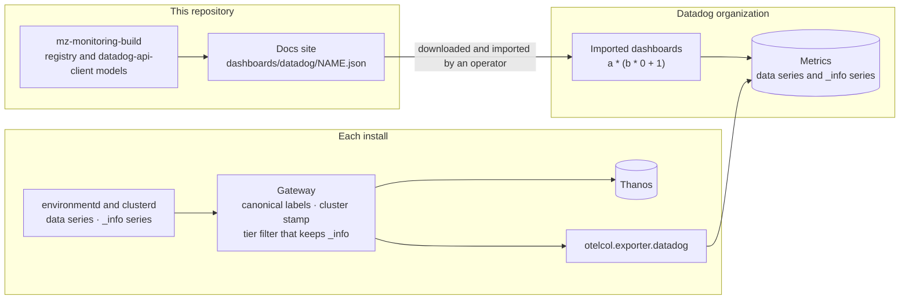

# Datadog dashboards from the query registry

date: 2026-10-20


# Datadog dashboards from the query registry


<table class="param-table">
  <tbody>
        <tr>
          <th>agent</th>
          <td>Claude Opus 5.5</td>
        </tr>
        <tr>
          <th>author</th>
          <td>Heather Lapointe</td>
        </tr>
        <tr>
          <th>lastmod</th>
          <td>2026-10-21 00:00:00 &#43;0000 UTC</td>
        </tr>
        <tr>
          <th>publishdate</th>
          <td>2026-10-20 00:00:00 &#43;0000 UTC</td>
        </tr>
        <tr>
          <th>status</th>
          <td>Draft</td>
        </tr>
  </tbody>
</table>


This doc proposes how `materialize-monitoring` builds a Datadog dashboard set from the query registry that the Grafana dashboards already read.
It owes [DEP-115](https://linear.app/materializeinc/issue/DEP-115), whose description predates the Rust dashboards rewrite in [DEP-222](https://linear.app/materializeinc/issue/DEP-222) and names paths that no longer exist.
In this doc, "you" is a contributor to this repository or an agent working for one.

The central claim is that **the Datadog set adds nothing to the install.**
The dashboards are JSON files that an operator downloads from the docs site and imports into Datadog.
Where a panel shows names rather than ids, it gets them by formula arithmetic in Datadog, against the `_info` series the gateway already collects.
What the set needs from the stack is a change to which series the gateway sends and how they're labeled, and no new component.

<!--
Agent note: this doc records decisions and their why. When a decision lands in code, update the section and
check the matching row in "Chart-side prerequisites".

Four claims here are load-bearing and easy to soften by accident:
  1. No Datadog dashboard renders under charts/. Grafana's dashboards are the only ones that live in the cluster,
     and every file in a chart counts against the release's size ceiling. Shaped by the author, 2026-10-20.
  2. Names are a SHOULD. A panel that shows ids is correct and shippable; names are an improvement on it.
  3. The arithmetic join's matching rules are not documented by Datadog (checked 2026-10-20). What this doc says
     about it comes from a join the author built in the Datadog UI. Re-test rather than assume, and record what
     the tests show in "How the arithmetic join behaves".
  4. A PromQL endpoint, Thanos by default, is present even when Datadog is a destination, because the tenant-scoped
     read path depends on it. Do not design for an install that sends metrics only to Datadog.

The parity ledger compares manifests that the builders record, never the rendered JSON. A shared panel layer waits for the
ledger to show duplication; do not build it ahead of that.

Reference tables were the first draft's answer for names. They are recorded under "Other ways to get names" as an
option, with the constraints that research found, so that the work is not repeated.

The environment key belongs to the label-vocabulary design (PR #445). This doc consumes it; do not reopen the
choice here.

Counts (228 of 734 queries with a datadogQuery, 1,249 v1 schemas) were measured on 2026-10-20. Re-measure
rather than hedge.
-->

## Goals

The goals come from the following stakeholders:

- **Operators** who send metrics to Datadog through the gateway's Datadog destination.
- **Field Engineering and support**, who read those dashboards alongside a customer.
- **Maintainers** of this repository, who keep two dashboard backends in step.

Functional requirements are framed as value-first user stories.
Priority tags (**Must** / **Should** / **Could**) are relative to the first shipped version.

- **[Must] As an operator who uses Datadog,** I want to download a Materialize dashboard set from the docs and import it, so that I don't rebuild the Grafana dashboards by hand.
- **[Must] As an operator with several environments in one Datadog organization,** I want every panel scoped to one environment at a time, so that two environments' series never merge into one line.
- **[Must] As a maintainer,** I want a Datadog panel and its Grafana counterpart to render from one registry entry, so that the two backends can't disagree about what a number means.
- **[Should] As an operator,** I want clusters, replicas, and objects shown by name, so that a panel answers "which one" without a lookup in SQL.
- **[Should] As an operator,** I want a rename to change the name a panel shows without changing the series underneath, so that a rename doesn't reset rates or history.
- **[Should] As a maintainer,** I want a change in Datadog's API to fail CI rather than a customer's import, so that published dashboard JSON doesn't age out of compatibility.
- **[Should] As a maintainer,** I want a panel added to one set to fail CI until the other set has it or the gap is listed, so that the two sets don't drift apart unnoticed.
- **[Could] As an operator who uses Terraform,** I want to manage the downloaded dashboards as Terraform resources, so that I manage them the way I manage the rest of the install.
- **[Could] As an operator,** I want to pick a cluster by name in a dashboard variable, so that I don't have to know its id.

## Technical BLUF

- **The dashboards ship as downloadable JSON on the docs site, never in a chart.** The docs site's `download-dashboards` shortcode already has a Datadog row that reads `docs/assets/dashboards/datadog/NAME.json`. The Grafana dashboards are the only ones that live in the cluster.
- **The backend builds on the models in `datadog-api-client`, Datadog's official Rust client.** The crate is generated from Datadog's OpenAPI spec. The workspace already builds its HTTP stack, so the added cost is compiling the models.
- **Names, where a panel shows them, come from formula arithmetic.** A formula such as `a * (b * 0 + 1)`, with `b` an `_info` query grouped by the id and the name, keeps `a`'s values and carries `b`'s extra tags. It's Datadog's counterpart to `* on (id) group_left (name)`.
- **The join matches on tag names, so both sides have to spell the id and the environment the same way.** Datadog can't rename a tag inside a query. The relabel rules from the label-vocabulary design give both sides the canonical names, and names in Datadog wait on them.
- **The `_info` series have to reach Datadog.** Two of the three aren't in the metric tier list today, so the Datadog destination's default tier drops them. Each `_info` series that does reach Datadog is a custom metric.
- **Reference tables stay an option, outside the first version.** They solve names without sending `_info` series, at the price of a sync component, an application key, and a join shape that Datadog doesn't publish for dashboards.
- **Thanos is always there.** The tenant-scoped read path makes a PromQL endpoint part of every deployment, Datadog destination or not. That keeps pre-joined recording rules available as an option too.
- **A parity ledger keeps the two sets in step.** Each backend records a manifest of its panels, their registry queries, kinds, and units, and a test fails on any difference that isn't listed with a reason. A shared panel layer follows only if the ledger shows the two backends repeating one list.

## Non-goals

- **Installing dashboards from the cluster.** No chart carries Datadog JSON, and nothing in the install calls Datadog's dashboard API.
- **Reference tables in the first version.** See [Other ways to get names](#other-ways-to-get-names).
- **Datadog monitors.** Alerting stays in the Prometheus rules and Alertmanager that this stack ships, as designed in [Alerting in Self-Managed](../20260917-alerting-self-managed/).
- **Collection through the Datadog Agent.** The stack sends metrics through the gateway's `otelcol.exporter.datadog`. The Agent's OpenMetrics check can copy labels between metrics at scrape time, and this design doesn't rely on it.
- **Parity with every Grafana dashboard in the first version.** See [Scope of the first set](#scope-of-the-first-set).
- **Datadog log dashboards.** The Datadog destination forwards logs too, and their dashboards are a separate design.
- **The label vocabulary.** [A Label Vocabulary for Materialize Metrics](https://github.com/MaterializeInc/materialize-monitoring/pull/445) owns label names and the environment key. This doc consumes its decisions.
- **The Google Cloud Monitoring and Honeycomb sets** ([DEP-217](https://linear.app/materializeinc/issue/DEP-217), [DEP-218](https://linear.app/materializeinc/issue/DEP-218)). They share the registry, and their join stories differ from Datadog's.

## What exists today

The following table lists what a Datadog dashboard set can build on, as of 2026-10-20.

| Piece | State | Where |
|---|---|---|
| Datadog metrics destination | ✅ Shipped | `otelcol.exporter.datadog` in the gateway, configured under `pipeline.metrics.gateway.destination.otel.datadogExporter`, at tier `recommended` by default |
| A download row for Datadog JSON | ✅ Shipped | `docs/layouts/_shortcodes/download-dashboards.html` lists a Datadog format at `dashboards/datadog/%s.json`, and shows it as absent until a render exists |
| The Datadog dashboards page | ⚠️ Placeholder | `docs/content/dashboards/datadog.md` says no set exists, and points at Common Queries |
| Datadog query templates | ⚠️ Partial | 228 of the registry's 734 queries carry a `datadogQuery`. The clusters, compute, connections, kubernetes, and storage files are covered. Consensus, persist, generations, operator, and every `infra-*` file except `infra-alerts.yaml` aren't. The templates are best-effort and less tested than the PromQL |
| Name enrichment for Datadog | ❌ Missing | `mzClusterName`, `mzObjectName`, and `mzEnvironmentName` attach only to `promQL` templates, where `packages/mzmon-lib/src/query/enrich.rs` renders them as `group_left` joins. No `datadogQuery` takes a `functions` list |
| Arithmetic matching, as a known Datadog behavior | ⚠️ Noted | [Datadog Translations](../../queries/datadog/) records that Datadog matches tags automatically in arithmetic between two queries, and uses it for nothing yet |
| `_info` series at Datadog's default tier | ⚠️ Partial | `mz_cluster_info` is in the tier allowlist, because a query names it directly. `mz_object_info` and `mz_replica_info` are reached only through enrichment functions, which tier extraction treats as the identity, so a destination below `all` drops them |
| Matching tag names on both sides of a join | ❌ Missing | `mz_cluster_info` carries `cluster_id` and `name`, and the series it names carry `instance_id`. `mz_object_info` carries `global_id`, and the series it names carry `collection_id`. [DEP-349](https://linear.app/materializeinc/issue/DEP-349) relabels both sides to canonical names |
| `cluster` on Datadog series | ❌ Missing | Remote-write destinations get it from `external_labels`, and the Google Cloud chain fills it from `CLUSTER_NAME`. The Datadog chain doesn't |
| `environment_id` on series | ⬜ Designed | In the label-vocabulary design. [DEP-351](https://linear.app/materializeinc/issue/DEP-351) waits on the orchestratord pod label in [DEP-348](https://linear.app/materializeinc/issue/DEP-348) |
| A Datadog backend in `packages/dashboards` | ⬜ Not started | `packages/dashboards/src/lib.rs` already places one beside `grafana/` |
| `legacy/datadog/` | ⚠️ Superseded | A Datadog Agent config that scrapes a SQL exporter, and scripts that upload and check one hand-written dashboard |

## Architecture



The following properties of this diagram carry the design.

**Nothing new runs in the install.**
The gateway's labels and tier filter change, and no component is added.

**A dashboard reaches Datadog through a person, not through the cluster.**
An operator downloads it from the docs site and imports it, so the install holds no Datadog application key.

**The join happens in Datadog, when a panel's query runs, over tags both series already carry.**
Names never go onto the data series, so a rename changes no series' identity.

## The backend

### Models from `datadog-api-client`

The Datadog backend lives in `packages/dashboards/src/datadog/`, beside `grafana/`, where `packages/dashboards/src/lib.rs` already expects a second backend.
It builds dashboards from the models in [`datadog-api-client`](https://crates.io/crates/datadog-api-client), Datadog's official Rust client.
The crate is generated from Datadog's OpenAPI spec and licensed Apache-2.0, and its 0.38.0 release is from 2026-10-13.
Its `datadogV1::model` module types the dashboard, its tabs and template variables, and each widget definition.

The backend uses the models and not the client.
The dependency is `default-features = false, features = ["rustls-tls"]`.
`reqwest` isn't optional in the crate, but `mz-monitoring-build` already builds `reqwest` 0.13 with rustls.
The crate covers Datadog's whole v1 and v2 API, so compiling its models is the largest cost of this choice.

Queries come from the registry through `QueryEngine::Datadog`, the same way the Grafana backend renders PromQL.
The output is plain dashboard JSON, one file per dashboard.

### What the spec doesn't describe

Every model in the crate keeps the fields it doesn't know in a flattened `additional_properties` map.
Every `oneOf` union, including the widget query union `FormulaAndFunctionQueryDefinition`, has an `UnparsedObject` variant.
A field or query type that the spec lacks therefore round-trips without a type.

A dashboard exported from the Datadog UI can carry shapes the spec doesn't describe.
A table widget built in the UI's table editor, for example, exports `request_type: "table"` with `rows` and `columns`, and metric queries with `metric_name` and `filter`.
The backend emits the spec's form of the same table instead: a metric query grouped with `by {…}`, its formulas, and `response_format: "scalar"`.

### Generated models, considered

The alternative is the approach the Grafana backend takes.
`bin/gen-grafana-models.sh` runs `cargo typify` over vendored JSON Schema documents, and generates only the packages the dashboards use.
The dashboard part of Datadog's OpenAPI spec could be vendored and generated the same way.
The result would be smaller and model-only.
It would also mean maintaining a normalization from OpenAPI 3.0 to JSON Schema, over a v1 spec with 1,249 schemas, which the crate's maintainers already do.
Generated models stay the fallback if the crate's compile time becomes a problem.

## Delivery: a download from the docs site

`make datadog-dashboards` renders each dashboard to `docs/assets/dashboards/datadog/NAME.json`.
The `download-dashboards` shortcode already lists a Datadog row for every dashboard, and offers the file as soon as it exists.
An operator downloads the file and imports it into Datadog, through the UI or `POST /api/v1/dashboard`.
An operator who uses Terraform can pass the same file to the Datadog provider's `datadog_dashboard_json` resource.

No chart carries the JSON.
The Grafana dashboards are the only dashboards that live in the cluster.
Helm stores each release, its chart files included, in a Kubernetes Secret, and a Secret can't exceed 1 MiB.
A Datadog set in a chart would spend that ceiling on files nothing in the cluster reads.
The empty placeholder at `charts/materialize-monitoring-dashboards/pre-rendered/dashboards/datadog/` is removed in this change for the same reason.

The dashboards carry template variables for the environment and the Kubernetes cluster, defaulting to every value.
Each panel groups by those tags as well as its own, so an organization with several environments sees one line per environment rather than a merged one.

## Names come from formula arithmetic

### The arithmetic join

Datadog matches series by their tags when a formula combines two grouped metric queries.
The repository's [Datadog Translations](../../queries/datadog/) page records the behavior, and a join built in the Datadog UI on 2026-10-20 shows it working as a label join:

```text
a: sum:kube_pod_status_ready{*} by {pod,namespace}
b: sum:kube_pod_info{*} by {pod,namespace,node,pod_ip}
formula: a * (b * 0 + 1)
```

`b * 0 + 1` is `1` wherever `b` has a point, so the product keeps `a`'s values.
The result carries `b`'s extra tags, `node` and `pod_ip`, the way `* on (pod, namespace) group_left (node, pod_ip)` would in PromQL.
`b` can be hidden in the widget, because Datadog still evaluates a hidden query in the formulas that use it.

For a Materialize panel, `b` is an `_info` query grouped by the environment's tags, the id, and the name.
The following example uses the canonical label names, which [the join needs](#what-the-join-needs-from-the-series):

```text
a: max:mz_dataflow_wallclock_lag_seconds{$environment} by {cluster,environment_id,cluster_id,collection_id}
b: max:mz_object_info{$environment} by {cluster,environment_id,collection_id,object_name}
formula: a * (b * 0 + 1)
```

The match is on every tag the two queries share, so a `u1` in one environment matches only its own environment's `_info` series.
No composite key is needed.

### How the arithmetic join behaves

Datadog's documentation doesn't describe how a formula matches series between queries with different group-bys, as of 2026-10-20.
The following table lists what the design depends on, and what is known about each:

| Behavior | What the design needs | Known |
|---|---|---|
| A series on the left with no match on the right | Kept, so a panel never loses a series to a missing `_info` row | Untested |
| One left series matching two right series | Two result series, one per name, as across a rename | Untested |
| A right series with no point at a timestamp | The left point kept or interpolated | Datadog interpolates gauges by default. An `_info` series is scraped every interval, so a gap is normally one interval |
| The join in every widget the set uses | Timeseries, query value, toplist, and table | Seen in a table widget |
| Formulas that already do arithmetic | The join added to the panel's own formula | Datadog can't do arithmetic between formulas, so the join goes into the same formula, as in `(a / c) * (b * 0 + 1)` |

The first dashboard's port settles each untested row in a test organization, and this section records the results.
If an unmatched series turns out to be dropped, a panel that joins names loses series whenever an `_info` row is missing, and that panel ships with ids instead.

### What the join needs from the series

The join needs the following from the series that reach Datadog:

Matching tag names
: Datadog can't rename a tag inside a query, so an id has to carry the same tag name on both sides.
  Today it doesn't: `mz_cluster_info` names a cluster `cluster_id` where the series it names say `instance_id`, and `mz_object_info` says `global_id` where they say `collection_id`.
  The relabel rules in [DEP-349](https://linear.app/materializeinc/issue/DEP-349) copy each alias to its canonical name in the shipped monitors, on both sides.
  Names in Datadog wait on them.

The environment's tags on both sides
: Both queries group by `cluster` and the environment's id, so the match can't cross environments.
  Until [DEP-351](https://linear.app/materializeinc/issue/DEP-351) puts `environment_id` on the series, the environment's tags are `namespace` and `materialize_cloud_organization_name`.

`cluster` on the Datadog chain
: The Datadog chain doesn't put `cluster` on series today.
  The prerequisite is to fill it from `CLUSTER_NAME` where it's absent, as the remote-write `external_labels` and the Google Cloud chain already do.
  An organization that receives several Kubernetes clusters needs a distinct `clusterName` for each, and the Datadog dashboards page says so.

The `_info` families at the destination's tier
: Tier extraction treats the enrichment functions as the identity, so `mz_object_info` and `mz_replica_info` aren't in the tier list.
  The fix is for extraction to count the `_info` family an enrichment function reads, at the importance of the query that reads it.
  Each `_info` series in Datadog is a custom metric, one per catalog object, cluster, or replica, and the Datadog dashboards page says so.

### One enrichment declaration, two realizations

A registry query asks for names by attaching an enrichment function, such as `mzObjectName` or `mzClusterName`, to its template.
The PromQL rendering context implements each function as a `group_left` join, through `packages/mzmon-lib/src/query/enrich.rs`.
The extraction context, which builds the docs and the tier list, implements each function as the identity.

The `datadogQuery` templates gain the same `functions` list.
The Datadog rendering context implements each function as a hidden `_info` query and a factor on the panel's formula.
`mzObjectName` over `collection_id`, for example, adds `b: max:mz_object_info{…} by {…,collection_id,object_name}` and turns the formula `F` into `(F) * (b * 0 + 1)`.
A panel that shows names says so once, in its registry entry, and both backends follow it.

## Other ways to get names

### Reference tables

A [reference table](https://docs.datadoghq.com/reference_tables/) is a keyed table stored in Datadog.
[Reference Table Joins with Metrics](https://docs.datadoghq.com/metrics/reference_table_joins_with_metrics) add a table's columns to a metric query's result as tags, matching one tag of the query to the table's key.
They would give names without sending any `_info` series to Datadog.

They're outside the first version, for the following reasons:

- **One attribute, one key.** A join matches one tag to one column, and a table has one primary key. Catalog ids repeat in every environment, so the key would be a composite tag, such as `<cluster>/<environment_id>/<id>`, built in the gateway for both the series and the rows.
- **A component in the install.** Something has to keep the rows current. That would be a sync per install, writing rows through `POST` and `DELETE /api/v2/reference-tables/tables/{id}/rows`, which needs no CSV upload or bucket. It would read the `_info` series from Thanos, which every install has.
- **A Datadog application key in the cluster.** The Reference Tables API needs one with `reference_tables_write`, which the metrics exporter doesn't.
- **An unpublished shape.** Datadog's spec describes the join for monitors, in `MonitorFormulaAndFunctionAggregateAugmentedQueryDefinition`, and has no variant for it among the dashboard widget queries. The shape would have to come from a UI export.
- **Shared tables.** A join names one table, so every install in an organization would write to the same tables, each deleting only its own rows.

Reference tables become worth their cost if the arithmetic join drops unmatched series, if the custom metrics for `_info` series cost too much, or if a cluster has to be picked by name.

### Pre-joined recording rules

The Thanos Ruler remote-writes its results to the gateway, and every install has Thanos, so a recording rule that joins names onto series would reach Datadog with no new component.
This design doesn't use it for the dashboards, for the following reasons:

- A destination below the `all` tier drops recorded series until [DEP-368](https://linear.app/materializeinc/issue/DEP-368) gives them a tier.
- Both ruler replicas send every result. Datadog doesn't deduplicate on `ruler_replica`, so each copy is a custom metric of its own.
- A name on a series is part of the series' identity. A rename ends one series and starts another, which is why the label-vocabulary design keeps names on `_info` metrics only.

## Scope of the first set

DEP-115 asks whether the first version is full parity with the Grafana set or a subset.
This doc proposes a subset, starting with `env-top`.
Its registry entries already carry Datadog templates, and the other dashboards link from it.
Field Engineering sets the order after that, as DEP-115 recommends.

The first set shows ids.
Names are a **Should**, and they wait on the canonical labels from [DEP-349](https://linear.app/materializeinc/issue/DEP-349), so each panel gains them when its labels match.

The `datadogQuery` templates were written for completeness, and the PromQL is the tested half.
Each panel's Datadog query is checked against live data when it's ported.

## Keeping the two sets in step

The registry already keeps the meaning of the two sets in step, because both backends name each query by its registry id.
What can still drift is everything around those queries: which panels exist, where they sit, which queries each one reads, and what kind of panel each one is.
This design checks that with a parity ledger now.
It moves the panel list into a shared layer only if the ledger shows the two backends repeating it.

### A parity ledger over panel manifests

Each backend produces a manifest of every dashboard it renders.
The manifest records the following for each panel, in section order:

Slug
: The panel's stable id. The Grafana builders already give every panel one, as in `.panel("freshness-lag-by-cluster", …)`.

Title
: The title the panel shows.

Queries
: The registry ids the panel reads, with any argument that changes what they select, such as a split by replica or by worker.

Kind
: A broad class of panel: time series, single value, table, or pie.

Unit
: The unit of the panel's values.

Names
: Whether the panel joins names, and through which enrichment function.

The builders record the manifest as they build each dashboard.
Every Grafana query lookup already passes through `Queries::bridge` in `packages/dashboards/src/grafana/queries.rs`, which records the lookups that fail.
Recording the lookups that succeed, against the panel being built, uses the same mechanism.

A test compares each Datadog dashboard's manifest with its Grafana counterpart's.
It fails when a panel is in one and not the other, or when the two disagree on a field, unless the difference is listed with its reason.
The listed differences live in one place, as `ALLOWED` and `ADDED_PANELS` do in `packages/dashboards/tests/env_top_parity.rs`, which compared the Rust `env-top` with its earlier render the same way.
Typical reasons are a log panel, a query with no `datadogQuery` yet, and a panel kind that Datadog has no counterpart for.
A long list means the ledger has stopped describing the two sets, and the comparison stops being worth running.

The ledger has the following further uses:

- The Datadog dashboards page renders the listed differences as a table of Grafana panels without a Datadog counterpart, each with its reason.
- A query that a Datadog panel needs and that has no `datadogQuery` fails the test until someone writes the template or lists the gap.

The ledger doesn't compare layout, sizes, colors, thresholds, legends, links, or transformations.
Those belong to each format, and comparing them would mostly report noise.

This design considered a structural comparison of the rendered JSON, and rejected it.
Grafana's grid, rows, field overrides, and transformations share almost nothing with Datadog's layout, groups, formulas, and conditional formats.
Comparing them would first mean normalizing both into a common shape, and that shape is the manifest, recovered from output after the builders have already discarded it.

### A shared panel layer, if the ledger shows duplication

This design also considered interlacing the two definitions now, with every panel builder rendering per backend, and rejected it.
The Grafana set is the one that lives in the cluster, and it uses features Datadog has no counterpart for: conditional rows, transformations, data links, log panels, and Grafana-only variable types.
Rendering every Grafana panel through a Datadog-aware builder would bring Datadog's limits into each one.
`packages/dashboards/src/lib.rs` also asks for shared structure to grow out of a second backend rather than be designed ahead of one.

If the ledger shows the two backends restating the same panel list, that list moves into a backend-neutral layer.
The layer holds what the manifest records: sections, slugs, titles, query ids, kinds, units, and name joins.
Each backend renders from it, and keeps its presentation in its own code, keyed by slug.
The ledger then reduces to one assertion: every shared panel renders in both backends, or is listed as skipped.

## Catching API drift

DEP-115 asks for a CI job that runs the SDK at its latest version and surfaces drift.
Renovate already proposes crate bumps.
The dashboards workflow already fails when a fresh render differs from the committed output.
Extending that check to the Datadog output makes a crate bump that changes the rendered JSON show its diff in Renovate's own pull request.

A render can't prove that Datadog accepts the JSON.
Datadog's v1 API has no validate-only dashboard endpoint, so proving acceptance means creating each dashboard in a test organization, reading it back, and deleting it.
That check runs on a schedule, because it needs credentials that pull requests from forks don't get.

## Chart-side prerequisites

Work in **this** repo, ordered roughly by dependency.
None of it is ticketed yet.

| Item | Why it's needed | Blocking? |
|---|---|---|
| **The Datadog backend** under `packages/dashboards/src/datadog/`, with `make datadog-dashboards` rendering into `docs/assets/dashboards/datadog/` and the freshness check in the dashboards workflow | The feature | **Blocking** |
| **Panel manifests and the parity ledger**: both backends record a manifest as they build, and a test compares them against a list of reasoned differences | Keeps the two sets in step | **Blocking** for the first Datadog dashboard |
| **The Datadog dashboards page**, rewritten from its placeholder into import steps | Download is the primary way to install the set | **Blocking** |
| **`cluster` on the Datadog chain**, filled from `CLUSTER_NAME` where it's absent | Environment scoping across Kubernetes clusters, and the Kubernetes-cluster identity every other destination already has | **Blocking** for organizations with several Kubernetes clusters |
| **`functions` on `datadogQuery` templates**, and a Datadog rendering context that turns the enrichment functions into a hidden `_info` query and a formula factor | How a panel asks for names | Blocking for names |
| **Tier extraction that counts the `_info` family an enrichment function reads** | Puts `mz_object_info` and `mz_replica_info` in the tier list | Blocking for names |
| **Canonical label names on both sides of a join**, from [DEP-349](https://linear.app/materializeinc/issue/DEP-349) | The join matches on tag names | Blocking for names. Owned by the label-vocabulary design |
| **The placeholder under `charts/materialize-monitoring-dashboards/pre-rendered/dashboards/datadog/`** removed | No chart carries Datadog JSON | ✅ Done in this change |

## Testing

The following tests cover the design:

- **Join behavior.** In a test organization, a panel joined to an `_info` query is checked for each row of [How the arithmetic join behaves](#how-the-arithmetic-join-behaves): an unmatched series, a rename inside the range, and each widget type the set uses.
- **Two environments, one organization.** Two environments with the same catalog ids send to one test organization, and each panel keeps them apart, with or without names.
- **Formula rewriting.** A unit test renders a registry query with `mzObjectName` and asserts the hidden `_info` query and the formula factor, including a formula that already does arithmetic.
- **Tier list.** The rendered `metric-tiers.yaml` names every `_info` family that an enrichment function reads.
- **The `cluster` stamp.** helm-unittest asserts that the Datadog chain fills `cluster` only where it's absent.
- **Parity.** The ledger compares every Datadog dashboard's manifest with its Grafana counterpart's, and a fixture with an unlisted difference makes it fail.
- **Renders.** Snapshot tests for each Datadog dashboard, as `packages/dashboards/tests/` holds for the Grafana ones.
- **API acceptance.** The scheduled job creates, reads back, and deletes every dashboard in a test organization.
- **Live data.** Every ported `datadogQuery` returns data against a test install that sends to Datadog.

## Documentation to update

- `dashboards/datadog.md`, from "no set exists" to the download and import steps, the distinct `clusterName` per Kubernetes cluster, and the custom-metric cost of the `_info` series. It also gains the ledger's table of Grafana panels without a Datadog counterpart.
- `dashboards/all.md`, which points Datadog users at the roadmap and at Common Queries.
- `reference/development/queries/datadog.md`, whose `label_replace` note says Datadog panels can't show names. The arithmetic join shows them once the tag names match.
- `metrics/storing.md`, whose Datadog destination section gains the `_info` families and their cost.
- The `dashboards-as-code` skill, which gains the Datadog backend.
- `reference/development/roadmap.md`. ✅ Done: a row under **Designs in flight**, and the DEP-115 row under **Dashboards**.
- `charts/materialize-monitoring/pre-rendered/README.md`. ✅ Done: it described dashboard output that moved to the dashboards chart, and a `rules/loki/` placeholder that holds generated rules.

## Open questions

- [ ] **What does the arithmetic join do at its edges?** An unmatched series, a many-to-many match, and each widget type are untested. See [How the arithmetic join behaves](#how-the-arithmetic-join-behaves).
- [ ] **Can a template variable on the `_info` query's name tag filter the joined result?** If the join drops unmatched series, filtering `b` by name filters the panel, which is the **[Could]** story.
- [ ] **Is the custom-metric cost of the `_info` series acceptable at the default tier**, or do they belong in a tier an operator opts into?
- [ ] **Do names wait for all of DEP-349**, or does the Datadog chain alias the few id labels the first set joins on ahead of it?
- [ ] **When are reference tables worth adding?** [Other ways to get names](#reference-tables) lists the conditions.
- [ ] **What duplication moves the panel list into a shared layer?** Two or more dashboards whose manifests match panel for panel would be a clear signal, and the threshold is a judgment call.
- [ ] **Does CI get a Datadog test organization** for the acceptance job and the live-data checks?
- [ ] **Which dashboards follow `env-top`?** Field Engineering's input, as DEP-115 asks.

