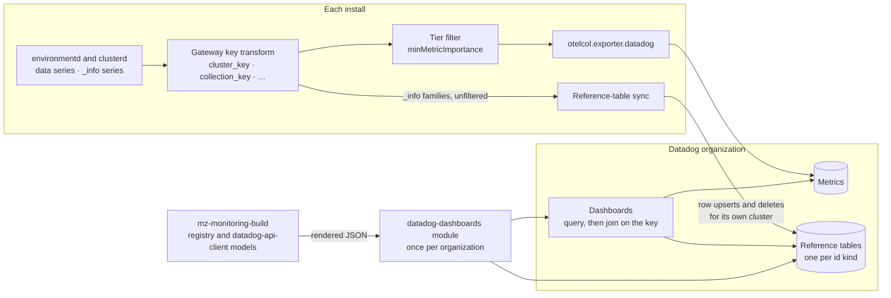

# Datadog dashboards from the query registry

date: 2026-10-20


# Datadog dashboards from the query registry


<table class="param-table">
  <tbody>
        <tr>
          <th>agent</th>
          <td>Claude Opus 5.5</td>
        </tr>
        <tr>
          <th>author</th>
          <td>Heather Lapointe</td>
        </tr>
        <tr>
          <th>lastmod</th>
          <td>2026-10-20 00:00:00 &#43;0000 UTC</td>
        </tr>
        <tr>
          <th>publishdate</th>
          <td>2026-10-20 00:00:00 &#43;0000 UTC</td>
        </tr>
        <tr>
          <th>status</th>
          <td>Draft</td>
        </tr>
  </tbody>
</table>


This doc proposes how `materialize-monitoring` builds a Datadog dashboard set from the query registry that the Grafana dashboards already read.
It also proposes how those dashboards show Materialize clusters, replicas, and objects by name.
It owes [DEP-115](https://linear.app/materializeinc/issue/DEP-115), whose description predates the Rust dashboards rewrite in [DEP-222](https://linear.app/materializeinc/issue/DEP-222) and names paths that no longer exist.
In this doc, "you" is a contributor to this repository or an agent working for one.

The central claim is that **catalog names are the one part of a Datadog dashboard set that the registry can't generate on its own.**
The Grafana dashboards attach names when a query runs, by joining each id-keyed series to an `_info` metric with `* on (id) group_left (name)`.
Datadog has no join between two metric queries.
The only join it offers is from a metric query to a reference table, so the names have to be written to a table that Datadog can join to, and kept current.
Porting the panels is translation work.
The reference-table sync, and the join key it shares with the series, are new machinery, and most of this doc is about them.

<!--
Agent note: this doc records decisions and their why. When a decision lands in code, update the section and
check the matching row in "Chart-side prerequisites".

Four claims here are load-bearing and easy to soften by accident:
  1. Datadog has no metric-to-metric join. Checked on 2026-10-20 against Datadog's docs and the v1 OpenAPI spec
     that datadog-api-client-rust generates from. Datadog ships query features often, so re-check before building
     on the absence, and do not assume it.
  2. A join matches one attribute on each side, and a reference table has one primary key. That is the whole
     reason the key is a single composite tag rather than a match on several tags.
  3. The gateway builds the key once, before the fan-out to the Datadog exporter and the sync. Do not move key
     construction into the sync. The two sides agreeing by construction is the property the design rests on.
  4. The widget JSON for a join is not in the public spec. Do not build more than the first dashboard's joins
     until a UI export has settled the shape.

The environment key belongs to the label-vocabulary design (PR #445). This doc consumes it; do not reopen the
choice here.

Counts (228 of 734 queries with a datadogQuery, 1,249 v1 schemas) were measured on 2026-10-20. Re-measure
rather than hedge.
-->

## Goals

The goals come from the following stakeholders:

- **Operators** who send metrics to Datadog through the gateway's Datadog destination.
- **Field Engineering and support**, who read those dashboards alongside a customer.
- **Maintainers** of this repository, who keep two dashboard backends in step.

Functional requirements are framed as value-first user stories.
Priority tags (**Must** / **Should** / **Could**) are relative to the first shipped version.

- **[Must] As an operator who uses Datadog,** I want a Materialize dashboard set I can install, so that I don't rebuild the Grafana dashboards by hand.
- **[Must] As an operator,** I want clusters, replicas, and objects shown by name, so that a panel answers "which one" without a lookup in SQL.
- **[Must] As an operator with several environments in one Datadog organization,** I want each id to resolve to its own environment's name, so that two environments' `u1` clusters never show each other's names.
- **[Must] As a maintainer,** I want a Datadog panel and its Grafana counterpart to render from one registry entry, so that the two backends can't disagree about what a number means.
- **[Should] As an operator,** I want a renamed cluster to show its new name without a break in its series, so that a rename doesn't look like an outage.
- **[Should] As an operator who uses Terraform,** I want the dashboards and their tables as Terraform resources, so that I manage them the way I manage the rest of the install.
- **[Should] As a maintainer,** I want a change in Datadog's API to fail CI rather than a customer's import, so that committed dashboard JSON doesn't age out of compatibility.
- **[Could] As an operator,** I want to pick a cluster by name in a dashboard variable, so that I don't have to know its id.

## Technical BLUF

- **The backend builds on the models in `datadog-api-client`, Datadog's official Rust client.** The crate is generated from Datadog's OpenAPI spec and released every few weeks. The workspace already builds its HTTP stack, so the added cost is compiling the models.
- **Datadog can't join two metric queries, so names come from reference tables.** A reference table is a keyed table that Datadog joins to a metric query when the query runs, adding its columns as tags.
- **A sync in each install writes the tables from the `_info` series the gateway already collects.** It upserts and deletes rows through the Reference Tables API, so it needs no CSV upload, no bucket, and no `COPY TO`.
- **The join key is one tag that combines `cluster`, the environment, and the entity's id.** A join matches one attribute on each side, a table has one primary key, and catalog ids such as `u1` repeat in every environment.
- **The gateway builds the key once, before the series reach either the Datadog exporter or the sync.** The series and the table rows can't disagree about a key, including across the change from today's environment label to `environment_id`.
- **Tables and dashboards belong to the Datadog organization, and the sync belongs to the install.** A Terraform module applied once per organization creates the tables and the dashboards, and each install's sync writes only its own rows.
- **The dashboard JSON for a join is unpublished.** Datadog's spec describes the join for monitors and not for dashboard widgets, so the first dashboard settles the shape from a UI export before the rest are built.

## Non-goals

- **Datadog monitors.** Alerting stays in the Prometheus rules and Alertmanager that this stack ships, as designed in [Alerting in Self-Managed](../20260917-alerting-self-managed/).
- **Collection through the Datadog Agent.** The stack sends metrics through the gateway's `otelcol.exporter.datadog`. The Agent's OpenMetrics check can copy labels between metrics at scrape time, and this design doesn't rely on it.
- **Parity with every Grafana dashboard in the first version.** See [Scope of the first set](#scope-of-the-first-set).
- **Datadog log dashboards.** The Datadog destination forwards logs too, and their dashboards are a separate design.
- **The label vocabulary.** [A Label Vocabulary for Materialize Metrics](https://github.com/MaterializeInc/materialize-monitoring/pull/445) owns label names and the environment key. This doc consumes its decisions.
- **The Google Cloud Monitoring and Honeycomb sets** ([DEP-217](https://linear.app/materializeinc/issue/DEP-217), [DEP-218](https://linear.app/materializeinc/issue/DEP-218)). They share the registry, and their join stories differ from Datadog's.

## What exists today

The following table lists what a Datadog dashboard set can build on, as of 2026-10-20.

| Piece | State | Where |
|---|---|---|
| Datadog metrics destination | ✅ Shipped | `otelcol.exporter.datadog` in the gateway, configured under `pipeline.metrics.gateway.destination.otel.datadogExporter`, at tier `recommended` by default |
| Datadog query templates | ⚠️ Partial | 228 of the registry's 734 queries carry a `datadogQuery`. The clusters, compute, connections, kubernetes, and storage files are covered. Consensus, persist, generations, operator, and every `infra-*` file except `infra-alerts.yaml` aren't. The templates are best-effort and less tested than the PromQL |
| Name enrichment for Datadog | ❌ Missing | `mzClusterName`, `mzObjectName`, and `mzEnvironmentName` attach only to `promQL` templates, where `packages/mzmon-lib/src/query/enrich.rs` renders them as `group_left` joins. No `datadogQuery` takes a `functions` list |
| `_info` series at Datadog's default tier | ⚠️ Partial | `mz_cluster_info` is in the tier allowlist, because a query names it directly. `mz_object_info` and `mz_replica_info` are reached only through enrichment functions, which tier extraction treats as the identity, so a destination below `all` drops them |
| `cluster` on Datadog series | ❌ Missing | Remote-write destinations get it from `external_labels`, and the Google Cloud chain fills it from `CLUSTER_NAME`. The Datadog chain doesn't |
| `environment_id` on series | ⬜ Designed | In the label-vocabulary design. [DEP-351](https://linear.app/materializeinc/issue/DEP-351) waits on the orchestratord pod label in [DEP-348](https://linear.app/materializeinc/issue/DEP-348) |
| A Datadog backend in `packages/dashboards` | ⬜ Not started | `packages/dashboards/src/lib.rs` already places one beside `grafana/` |
| Rendered Datadog output | ⚠️ Placeholder | `charts/materialize-monitoring-dashboards/pre-rendered/dashboards/datadog/` holds only `.gitkeep`, and no chart template reads it |
| A published image other than Alloy | ❌ None | `packages/alloy/Dockerfile` builds the only image this repository publishes |
| `legacy/datadog/` | ⚠️ Superseded | A Datadog Agent config that scrapes a SQL exporter, and scripts that upload and check one hand-written dashboard |

## Architecture



The following properties of this diagram carry the design.

**The key is built before the fan-out.**
The series and the rows pass through the same statements, so a key in a query and a key in a table can't disagree.

**The sync's feed bypasses the tier filter.**
Names keep working at any `minMetricImportance`, including the default.

**The install and the organization are separate scopes.**
Each install owns its rows.
The organization owns the tables and the dashboards, and applies them once.

**Nothing calls into the install.**
The sync only calls out to Datadog, and Datadog holds no credential for the cluster.

## The backend

### Models from `datadog-api-client`

The Datadog backend lives in `packages/dashboards/src/datadog/`, beside `grafana/`, where `packages/dashboards/src/lib.rs` already expects a second backend.
It builds dashboards from the models in [`datadog-api-client`](https://crates.io/crates/datadog-api-client), Datadog's official Rust client.
The crate is generated from Datadog's OpenAPI spec and licensed Apache-2.0, and its 0.38.0 release is from 2026-10-13.
Its `datadogV1::model` module types the dashboard, its tabs and template variables, and each widget definition.

The backend uses the models and not the client.
The dependency is `default-features = false, features = ["rustls-tls"]`.
`reqwest` isn't optional in the crate, but `mz-monitoring-build` already builds `reqwest` 0.13 with rustls.
The crate covers Datadog's whole v1 and v2 API, so compiling its models is the largest cost of this choice.

Queries come from the registry through `QueryEngine::Datadog`, the same way the Grafana backend renders PromQL.
The output is plain dashboard JSON, one file per dashboard.

### What the spec doesn't describe

Every model in the crate keeps the fields it doesn't know in a flattened `additional_properties` map.
Every `oneOf` union, including the widget query union `FormulaAndFunctionQueryDefinition`, has an `UnparsedObject` variant.
A field or query type that the spec lacks therefore round-trips without a type.
The backend relies on that for the [join](#the-widget-json-for-a-join-is-unpublished), and avoids it everywhere else.

A dashboard exported from the Datadog UI can carry shapes the spec doesn't describe.
A table widget built in the UI's table editor, for example, exports `request_type: "table"` with `rows` and `columns`, and metric queries with `metric_name` and `filter`.
The backend emits the spec's form of the same table instead: a metric query grouped with `by {…}`, its formulas, and `response_format: "scalar"`.

### Generated models, considered

The alternative is the approach the Grafana backend takes.
`bin/gen-grafana-models.sh` runs `cargo typify` over vendored JSON Schema documents, and generates only the packages the dashboards use.
The dashboard part of Datadog's OpenAPI spec could be vendored and generated the same way.
The result would be smaller and model-only.
It would also mean maintaining a normalization from OpenAPI 3.0 to JSON Schema, over a v1 spec with 1,249 schemas, which the crate's maintainers already do.
Generated models stay the fallback if the crate's compile time becomes a problem.

## Names come from reference tables

### Datadog has no metric-to-metric join

Datadog combines metric queries with arithmetic, such as `query1 / query2`, which matches points rather than tags.
The table widget shows columns from separate queries, and it joins rows only where their group names are identical.
A query grouped by `collection_id` and an `_info` query grouped by `global_id` and `name` share no rows.

The join Datadog does offer is [Reference Table Joins with Metrics](https://docs.datadoghq.com/metrics/reference_table_joins_with_metrics).
A reference table is a table of rows stored in Datadog, with one primary-key column.
In the query editor, you pick a table, a join condition that matches one tag of a space-aggregated metric query to one column, and the columns to add to the result as tags.
The added tags exist only in that query's result.
Nothing is written to the series.

### One enrichment declaration, two realizations

A registry query asks for names by attaching an enrichment function, such as `mzObjectName` or `mzClusterName`, to its template.
The PromQL rendering context implements each function as a `group_left` join, through `packages/mzmon-lib/src/query/enrich.rs`.
The extraction context, which builds the docs and the tier list, implements each function as the identity.

The `datadogQuery` templates gain the same `functions` list.
The Datadog rendering context implements each function as a join requirement.
It rewrites the query's group-by from the id label to that id's [key tag](#the-join-key), and records the table and columns that the widget's request joins.
The widget builder then attaches the join to the request.
A panel that shows names says so once, in its registry entry, and both backends follow it.

### Pre-joined series, considered

The Thanos Ruler remote-writes its results to the gateway, so a recording rule that joins names onto series would reach Datadog with no new component.
This design rejects it for the dashboards, for the following reasons:

- The ruler evaluates through Thanos Query, so an install that sends metrics only to Datadog has no ruler.
- A destination below the `all` tier drops recorded series until [DEP-368](https://linear.app/materializeinc/issue/DEP-368) gives them a tier.
- Both ruler replicas send every result. Datadog doesn't deduplicate on `ruler_replica`, so each copy is a custom metric of its own.
- A name on a series is part of the series' identity. A rename ends one series and starts another, which is why the label-vocabulary design keeps names on `_info` metrics only.

## The join key

### One attribute, one primary key

A join condition matches one tag of the query to one column of the table.
The monitor spec's `join_condition` has one `base_attribute` and one `augment_attribute`, and the dashboard editor offers the same.
A reference table has one primary key, and the API's create request says "Only one primary key is supported".

Catalog ids are unique only within an environment.
`u1` is the first user cluster in every environment.
Two environments that send to one Datadog organization would each write a `u1` row, and the second would overwrite the first.
The key therefore names the environment as well as the id, in one tag.

### The key's form

The label-vocabulary design makes `(cluster, environment_id)` the globally unique environment key.
`cluster` is the Kubernetes cluster, from the chart's `clusterName`.
`environment_id` is the `Materialize` resource's `spec.environmentId`.
The join key is those two and the entity's id, joined with `/` and lowercased:

```text
<cluster>/<environment_id>/<id>
```

Each id label the registry joins on gets a key tag named for it, with `_id` replaced by `_key`.
`collection_id` gives `collection_key`, and `parent_source_id` gives `parent_source_key`.
The registry's id labels predate the vocabulary, so `instance_id` gives `instance_key` until [DEP-355](https://linear.app/materializeinc/issue/DEP-355) moves the registry onto canonical names.
A key tag is a function of labels the series already carries, so it adds no series and no custom metrics.

The following table lists the tables that the keys join, one per `_info` family and id kind:

| Table | Rows from | Keyed by |
|---|---|---|
| `materialize_clusters` | `mz_cluster_info` | The cluster id |
| `materialize_replicas` | `mz_replica_info` | The replica id |
| `materialize_objects` | `mz_object_info` | The catalog item id, `object_id` |
| `materialize_collections` | `mz_object_info` | The collection's global id, `collection_id` |

Each table's primary-key column is `key`.
The table names meet Datadog's rule of up to 56 characters in lowercase letters, digits, and underscores.

### Built once, in the gateway

The gateway builds every key tag in one `otelcol.processor.transform`, placed before the fan-out to the Datadog exporter and the sync.
Each statement has the following form:

```text
set(attributes["collection_key"], ConvertCase(Concat([attributes["cluster"], attributes["environment_id"], attributes["collection_id"]], "/"), "lower")) where attributes["collection_id"] != nil
```

The statements are generated from the registry's enrichment calls, and rendered into the chart's pre-rendered output beside `metric-tiers.yaml`.
A panel can't ask for a key the gateway doesn't build, because both come from the same registry entries.
Each `_info` family gets the same statement over its own id label, such as `global_id` on `mz_object_info` for `collection_key`.
The sync therefore receives each row's key already built.

### Before `environment_id` reaches the series

`environment_id` isn't on any series until [DEP-351](https://linear.app/materializeinc/issue/DEP-351) lands, and that waits on the orchestratord pod label in [DEP-348](https://linear.app/materializeinc/issue/DEP-348).
Until then, the environment part of the key is the namespace and the `Materialize` resource's name.
`materialize_cloud_organization_name` carries that name today.

```text
<cluster>/<namespace>/<materialize_cloud_organization_name>/<id>
```

The change to `environment_id` is one edit to the generated statements.
The series and the rows change on the same gateway rollout, because both pass through the statements.
Rows in the old form stay until they age out.
Points written before the change keep their names for the [retention period](#ownership-and-retention), and lose them after it.

### `cluster` has to be present, and distinct

The Datadog chain doesn't put `cluster` on series today.
The prerequisite is to fill it from `CLUSTER_NAME` where it's absent, as the remote-write `external_labels` and the Google Cloud chain already do.

The key is unique only if every install that sends to one Datadog organization has its own `clusterName`.
The chart's default is `default`, so two installs left at the default collide.
The chart warns when the sync is enabled and `clusterName` is `default`.

## The reference-table sync

### What it is

The sync is a small Rust service in this workspace, published as an image beside the Alloy image.
Each install runs it as one Deployment with one replica, enabled under the Datadog destination as `datadogExporter.referenceTables`.
It receives `_info` series and writes rows.
It serves no queries, and reads nothing from Datadog except its own rows.

### Fed by the gateway

The gateway sends the `_info` families to the sync over OTLP, from the output of the key transform.
That feed is taken before the tier filter.
`mz_object_info` and `mz_replica_info` aren't in the tier allowlist, so the Datadog exporter never receives them at its default tier, and the sync doesn't depend on that changing.

The following table lists the feeds this design considered and rejected:

| Feed | Why not |
|---|---|
| The sync scrapes environmentd itself | It repeats the gateway's discovery and network policy, and it would build keys in different code from the code that builds the series' keys |
| The sync queries Thanos | An install that sends metrics only to Datadog has no Thanos |
| `COPY TO` writes the catalog to a bucket, and the table reads the bucket | It needs SQL credentials, a bucket, a Materialize connection to it, Datadog read access to it, and a CronJob, because `COPY TO` runs once and isn't a sink |

The bucket route has one advantage.
Datadog refreshes a cloud-storage table every 5 minutes and drops the rows missing from the file, so deletion needs no code.
The API route puts deletion in the sync instead, and needs nothing outside the install except Datadog.

### Rows and writes

Each row holds the key in its `key` column, `cluster`, the environment's parts, and each label of its `_info` series under its canonical name.
On an interval, the sync compares the rows it has received with the rows it last wrote.
It upserts the changed rows through `POST /api/v2/reference-tables/tables/{id}/rows`, in batches within the request limit of 1 MiB and 20,971 rows.
It deletes rows through `DELETE /api/v2/reference-tables/tables/{id}/rows` after they have been absent for the retention period.
On start, it lists its own rows, so a restart doesn't lose track of what to delete.

### Ownership and retention

Every install's sync writes to the same tables, because a dashboard's join names one table.
Two installs never write the same key, because the key starts with `cluster`.
A sync deletes only rows whose `cluster` is its own.
Replacing a table's whole contents would erase the other installs' rows, so the sync never does.

A dropped object's row stays for a retention period, proposed at 7 days, so recent history keeps its names.
A renamed object's row is updated in place.
Its series keeps one identity, and every point in a dashboard's range shows the current name.

If the sync is down, the rows it already wrote keep serving.
Only objects created during the outage lack names, until the sync returns.
Upserts are idempotent, so two replicas that overlap during a rollout write the same rows.

### Credentials

The Reference Tables API takes the API key that the Datadog exporter already reads from `GATEWAY_OTEL_DEST_DATADOG_API_KEY`, and an application key.
The application key needs `reference_tables_read` and `reference_tables_write`, and belongs to a Datadog service account rather than a person.
The sync reads it from a Secret, like every other credential for the Datadog destination.
The `materialize-monitoring` Terraform module takes it the way `gateway_credentials.tf` takes the API key.

### Datadog's limits

The following limits come from [Datadog's reference tables documentation](https://docs.datadoghq.com/reference_tables/) and its v2 API spec:

- 100 reference tables per organization. This design uses one per id kind, a fixed set.
- 200 columns per table, and 500 KiB per row.
- 1 MiB and 20,971 rows per upsert request.
- No reference tables on the `ddog-gov.com` sites, where the dashboards use the [fallback](#the-widget-json-for-a-join-is-unpublished).

## Tables and dashboards belong to the organization

A join names one table, so every install in a Datadog organization shares the tables, and the dashboards that join them.
A Terraform module, `terraform/modules/datadog-dashboards`, is applied once per organization.
It creates the tables, with their schemas and no rows, and creates the dashboards with `datadog_dashboard_json` over the rendered JSON.
It's a module of its own, so that the `materialize-monitoring` module doesn't require the `datadog` provider.
For an organization that doesn't use Terraform, the documentation gives the API calls that create the tables and import each dashboard.

`make datadog-dashboards` renders the JSON into the module's directory, because Terraform reads files from inside its module.
It also renders into `docs/assets/dashboards/datadog/`, as the Grafana build does for its dashboards.
Helm can't install a Datadog dashboard, so no chart carries the JSON, and the empty placeholder under `charts/materialize-monitoring-dashboards/pre-rendered/dashboards/datadog/` goes away.

## The widget JSON for a join is unpublished

Datadog's public spec describes the join for monitors.
`MonitorFormulaAndFunctionAggregateAugmentedQueryDefinition` pairs a base query, which can be a metrics query, with an augment query.
The augment query names a reference table, its columns, and a filter.
A `join_condition` matches one `base_attribute` to one `augment_attribute`, with a `join_type` of `inner` or `left`.

The dashboard widget queries in the same spec, `FormulaAndFunctionQueryDefinition`, have no reference-table or augmented variant.
The UI builds joins in widgets, so the shape exists, and it isn't published.

The first dashboard settles the shape with the following steps:

1. In a test organization, build one timeseries widget and one table widget with a join in the Datadog UI.
2. Export the dashboard, and commit the two widgets as a fixture under `packages/dashboards/tests/`.
3. Model the join as a type in the Datadog backend, carried through the crate as an `UnparsedObject` query.
4. Create the fixture dashboard through the API, read it back, and compare, to prove the API accepts what the UI exports.

If the API refuses the exported shape, the panels keep their data and lose the join.
Each panel groups by the raw id, and a table widget beside it lists each key with its name, read from the `_info` series.
That fallback needs the `_info` families at the destination's tier, which is the one prerequisite it adds.
Sites without reference tables use the same fallback.

## Scope of the first set

DEP-115 asks whether the first version is full parity with the Grafana set or a subset.
This doc proposes a subset, starting with `env-top`.
Its registry entries already carry Datadog templates, and the other dashboards link from it.
Field Engineering sets the order after that, as DEP-115 recommends.

The `datadogQuery` templates were written for completeness, and the PromQL is the tested half.
Each panel's Datadog query is checked against live data when it's ported.

## Catching API drift

DEP-115 asks for a CI job that runs the SDK at its latest version and surfaces drift.
Renovate already proposes crate bumps.
The dashboards workflow already fails when a fresh render differs from the committed output.
Extending that check to the Datadog output makes a crate bump that changes the rendered JSON show its diff in Renovate's own pull request.

A render can't prove that Datadog accepts the JSON.
Datadog's v1 API has no validate-only dashboard endpoint, so proving acceptance means creating each dashboard in a test organization, reading it back, and deleting it.
That check runs on a schedule, because it needs credentials that pull requests from forks don't get.

## Chart-side prerequisites

Work in **this** repo, ordered roughly by dependency.
None of it is ticketed yet.

| Item | Why it's needed | Blocking? |
|---|---|---|
| **`cluster` on the Datadog chain**, filled from `CLUSTER_NAME` where it's absent | The key's first part, and the Kubernetes-cluster identity every other destination already has | **Blocking** for names |
| **Generated key statements**, rendered beside `metric-tiers.yaml`, and the transform that applies them before the Datadog fan-out | Puts the key on the series and on the `_info` rows | **Blocking** for names |
| **`functions` on `datadogQuery` templates**, and a Datadog rendering context that turns the enrichment functions into a key group-by and a join requirement | How a panel asks for names | **Blocking** for names |
| **The Datadog backend** under `packages/dashboards/src/datadog/`, with `make datadog-dashboards` and the freshness check in the dashboards workflow | The feature | **Blocking** |
| **The join fixture** from a UI export, with an API round-trip test | Settles the join's shape | **Blocking** for names beyond the first dashboard |
| **The sync**: its crate, its image in the container-images release, and a chart component with its Deployment, Service, NetworkPolicy, Secret wiring, and OTLP egress for the `_info` families | Writes the tables | **Blocking** for names. The dashboards can ship showing ids before it |
| **The `datadog-dashboards` Terraform module** | Creates the tables and dashboards once per organization | Blocking for the Terraform path, not for an API import |
| **An application-key input** on the `materialize-monitoring` Terraform module | The sync's credential, kept out of values | Blocking for the Terraform path |
| **A warning** when the sync is enabled and `clusterName` is `default` | Two installs left at the default write the same keys | Not blocking |
| **`mz_object_info` and `mz_replica_info` in the tier list** | The fallback's lookup widgets read them at the destination's tier. The sync doesn't need them there | Blocking only for the fallback |
| **The placeholder under `charts/materialize-monitoring-dashboards/pre-rendered/dashboards/datadog/`** removed | No chart carries Datadog JSON | Not blocking |

## Testing

The following tests cover the design, and the key-agreement test is the one the design rests on:

- **Key agreement.** A data series carrying `collection_id` and the `mz_object_info` series for the same object pass through the rendered gateway config, and come out with identical `collection_key` values.
- **Key statements.** helm-unittest asserts the rendered transform, including the fill-if-absent `cluster` and the lowercasing.
- **Two environments, one organization.** Two environments with the same catalog ids send to one test organization, and each panel shows each environment's own names.
- **Renders.** Snapshot tests for each Datadog dashboard, as `packages/dashboards/tests/` holds for the Grafana ones.
- **Join fixture.** The UI-exported join deserializes into the backend's types and serializes back unchanged.
- **API acceptance.** The scheduled job creates, reads back, and deletes every dashboard in a test organization.
- **Sync writes.** Against a fake Reference Tables API, upserts stay within the request limits, a `429` response backs off, and only changed rows are written.
- **Sync deletes.** A row is deleted only after the retention period, and only when its `cluster` is the sync's own.
- **Sync restarts.** A restarted sync rebuilds its deletion state from the rows it lists, and deletes nothing that is still present.
- **Live data.** Every ported `datadogQuery` returns data against a test install that sends to Datadog.

## Documentation to update

- A new operator page for the Datadog dashboards: installing the set, the application key, the distinct `clusterName` requirement, and the fallback on sites without reference tables.
- `dashboards/all.md`, which points Datadog users at the roadmap and at Common Queries.
- `metrics/storing.md`, whose Datadog destination section gains the sync and its credential.
- `metrics/architecture.md`, whose gateway diagram gains the key transform and the sync's egress.
- `getting-started/terraform.md`, which gains the per-organization module.
- The `dashboards-as-code` skill, which gains the Datadog backend.
- `reference/development/roadmap.md`. ✅ Done: a row under **Designs in flight**, and the Datadog rows under **Dashboards**.
- `charts/materialize-monitoring/pre-rendered/README.md`. ✅ Done: it described dashboard output that moved to the dashboards chart, and a `rules/loki/` placeholder that now holds generated rules.

## Open questions

- [ ] **What JSON does a dashboard widget carry for a reference-table join**, and does the Dashboards API accept what the UI exports? See [The widget JSON for a join is unpublished](#the-widget-json-for-a-join-is-unpublished).
- [ ] **Is the join generally available** on every Datadog site and plan? An older Datadog page described it as a Preview that needed enabling, and the current page says nothing about its status.
- [ ] **Does the join work in timeseries widgets**, or only in scalar and table ones? The docs require a space aggregation and don't list the widgets.
- [ ] **Can a template variable filter on a joined column?** If it can't, the **[Could]** story waits, and the pickers stay on ids.
- [ ] **Can a `LOCAL_FILE` table be created empty and written only through row upserts?** The create request makes `file_metadata` optional. Does the Terraform `datadog_reference_table` resource then report the sync's rows as drift?
- [ ] **What are the rows endpoints' rate limits**, and how soon does an upserted row appear in a join? The API documents a `429` response and no numbers.
- [ ] **How long does a dropped object's row stay?** The proposal is 7 days. Longer keeps names on older history, and costs rows that nothing current reads.
- [ ] **Do joined columns keep their case?** The gateway lowercases the key either way. A name added to a result as a tag might be lowercased by Datadog.
- [ ] **How do a dashboard set and syncs at different versions share one organization?** A dashboard that joins a column an older sync doesn't write shows no value for that install's rows.
- [ ] **Does the chart fail or warn on `clusterName: default`** with the sync enabled? A single install is fine at the default, which argues for a warning.
- [ ] **Does CI get a Datadog test organization** for the acceptance job and the live-data checks?
- [ ] **Which dashboards follow `env-top`?** Field Engineering's input, as DEP-115 asks.

