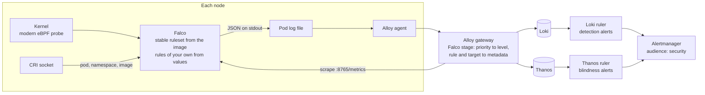

# Runtime security with Falco

date: 2026-10-27


# Runtime security with Falco


<table class="param-table">
  <tbody>
        <tr>
          <th>agent</th>
          <td>Claude Opus 5.5</td>
        </tr>
        <tr>
          <th>author</th>
          <td>Heather Lapointe</td>
        </tr>
        <tr>
          <th>lastmod</th>
          <td>2026-10-27 00:00:00 &#43;0000 UTC</td>
        </tr>
        <tr>
          <th>publishdate</th>
          <td>2026-10-27 00:00:00 &#43;0000 UTC</td>
        </tr>
        <tr>
          <th>status</th>
          <td>Draft</td>
        </tr>
  </tbody>
</table>


This doc proposes adding [Falco](https://falco.org/), the CNCF runtime security project, to `materialize-monitoring` as an optional component.
Falco watches the system calls on every node and reports activity that matches a rule, such as a shell spawned in a container or a binary written and then executed.
No Deployment-team issue tracks this yet.
It answers the platform half of the Security team's runtime-detection item, [SEC-671](https://linear.app/materializeinc/issue/SEC-671), which proposes Falco and leaves Falco the workload to the team that runs the cluster.
In this doc, "you" is a contributor to this repository or an agent working for one.

The central claim is that **Falco's detections travel paths the stack already has.**
A detection is a JSON log line on Falco's standard output, which the Alloy agent already tails and the gateway already routes to Loki.
Falco's health is a Prometheus endpoint, which the gateway already scrapes through a `ServiceMonitor`.
An alert on either is a rule on the rulers the stack already runs, through the Alertmanager it already runs.
What's new is the privileged DaemonSet itself, a gateway stage that understands Falco's priorities, a NetworkPolicy, and the rules.

<!--
Agent note: this doc records decisions and their why. When a decision lands in code, update the section and
check the matching row in "Chart-side prerequisites".

Four claims here are load-bearing and easy to soften by accident:
  1. Falco is off by default everywhere: in no tag group, `default` included, and off in the Terraform module and the
     per-cloud wrappers. It's a privileged DaemonSet that loads an eBPF program into every node's kernel, and it must
     never arrive in an upgrade.
  2. Nothing in the Falco pod downloads anything, at start or later. The ruleset and the container plugin come from the
     pinned image, which was checked for Falco 0.45.1 on 2026-10-27. A hardened or mirrored image that drops either
     breaks this claim, so check before adding a registry profile.
  3. The chart owns Falco the workload and never the detection logic. Rules of an operator's own arrive through values.
     The chart ships exceptions only for its own components, each with the calibration that justified it.
  4. Detection only. Nothing in the chart acts on a workload in response to a detection. Monitoring that takes down
     the thing it monitors is worse than monitoring that is late, which is the same reasoning as the
     `preemptionPolicy: Never` on the priority classes.

The gateway finding in "What exists today" (every Falco line lands at level UNKNOWN, in the droppable bucket) was read
from packages/alloy-pipelines/gateway.yaml on 2026-10-27, not observed live. Re-check it against the pipeline before
citing it again.

SEC-671 is an internal Security-team item. Cite its ownership split, and nothing else from it: this page is public.
-->

## Goals

The goals come from the following stakeholders:

- **Operators of self-managed Materialize** who want runtime threat detection on the nodes their deployment runs on.
- **Security teams**, at a customer or at Materialize, who write detection rules and triage what they find.
- **Materialize Cloud**, which adopts this chart for its own clusters and has a runtime-detection item of its own.
- **Maintainers** of this repository, who keep a privileged component inside a monitoring chart's security posture.

Functional requirements are framed as value-first user stories.
Priority tags (**Must** / **Should** / **Could**) are relative to the first shipped version.

- **[Must] As an operator,** I want to turn on runtime detection for every node in the cluster with one value, so that I don't integrate a separate security agent by hand.
- **[Must] As an operator,** I want Falco to stay off until I turn it on, so that a privileged DaemonSet never arrives in an upgrade.
- **[Must] As an operator,** I want each detection stored with the rule, the node, and the namespace, pod, and image it came from, so that I know which workload to look at.
- **[Must] As an operator of an air-gapped cluster,** I want Falco to run without downloading anything, so that it works with no internet access and runs exactly the rules that were reviewed.
- **[Must] As an operator,** I want to know when Falco is blind, because it's dropping kernel events or isn't running on a node, so that a quiet detection stream means nothing happened rather than nothing was watched.
- **[Should] As a security team,** I want to add rules of our own through values, so that they ship with the chart's release without a fork.
- **[Should] As a security team,** I want high-priority detections to reach our receiver rather than the platform on-call, so that the people who triage them are the ones notified.
- **[Should] As an operator,** I want a dashboard of detections and of Falco's health per node, so that I can see coverage and noise in one place.
- **[Could] As a security team,** I want detections forwarded to our SIEM, so that they join the rest of our security telemetry.
- **[Could] As an operator who already runs Falco,** I want the stack's parsing and alerts to work with my Falco, so that I don't run two.

## Technical BLUF

- **The upstream `falco` chart, as a subchart in no tag group.** It comes from `oci://ghcr.io/falcosecurity/charts`, version 9.2.1 with Falco 0.45.1 as of 2026-10-27, and turns on with `tags.falco: true`. The `postgres-exporter` subchart is the precedent.
- **The modern eBPF probe only, in least-privileged mode.** The probe is compiled once and relocated against the kernel's BTF at load, so there's no kernel module and no driver loader. The container gets a short list of capabilities instead of `privileged: true`.
- **Nothing is downloaded.** The upstream chart runs `falcoctl` to fetch the ruleset and the container plugin at start, and to poll for new rules weekly. The Falco image already contains both, so `falcoctl` stays off, and rules change only when the pinned image does.
- **Detections are log lines.** Falco writes JSON to standard output, and the agent ships it with every other pod's logs. A new gateway stage maps Falco's priority onto the pipeline's `level` and lifts the rule and the workload it names into structured metadata.
- **Falco's health is metrics.** Falco's Prometheus endpoint counts events, drops, and rule matches, and the gateway scrapes it through the subchart's `ServiceMonitor` with no change to discovery.
- **Detection alerts read Loki, and blindness alerts read Thanos.** The workload a detection names exists only in the log line, so detection alerts are LogQL. Drops and coverage are counters, so their alerts are PromQL. A derived `falco` capability installs both only where Falco runs.
- **A `security` audience routes detections.** Routes match on `audience`, and today's values are `platform`, `workload`, and `development`. None of them names the people who triage a detection.
- **Falco has no network egress.** The umbrella chart renders a NetworkPolicy that admits the gateway's scrape and denies all egress, because with `falcoctl` off nothing in the pod dials out.
- **Falco runs on every node.** It tolerates every `NoSchedule` taint, as the agent does, and takes the `monitoring-critical` priority class, because a node without it is a node nobody watches.

## Non-goals

- **Automated response.** Falco Talon, namespace quarantine, and anything else that acts on a workload stay out of the chart. `responseActions.enabled` stays `false`. SEC-671 treats the response policy as a decision for Security and the team that runs the cluster, outside this chart.
- **Authoring a Materialize ruleset.** The rules beyond Falco's stable set are owned by whoever triages them. The chart provides the hook.
- **Enforcement.** Seccomp profiles, LSM policy, and admission control prevent activity rather than detect it, and belong to the workloads' own charts or to the cluster.
- **Kubernetes audit-log detection.** Falco's `k8saudit` plugin reads the API server's audit stream. Each managed control plane delivers that stream differently, so it's a design of its own.
- **The kernel-module driver and the driver loader.** Both need privileges this design avoids, and the loader downloads or builds a driver at start.
- **`falcosidekick`.** It's a second component with its own egress and its own copy of output integrations the gateway already has. See [Why not falcosidekick](#why-not-falcosidekick).
- **On by default anywhere.** Not in the chart, the Terraform module, or the per-cloud wrappers.

## What exists today

The following table lists what Falco can build on, as of 2026-10-27.

| Piece | State | Where |
|---|---|---|
| Pod logs from every node | ✅ Shipped | The agent's `loki.source.file` tails every pod on its node except its own, in `packages/alloy-pipelines/agent.yaml` |
| A gateway stage for Falco's lines | ❌ Missing | No `stage.match` selects Falco. Its JSON keeps severity in `priority`, and the heuristic scan in `gateway.yaml` looks only for `level` and `severity`, so every detection lands at `level="UNKNOWN"`. That bucket is limited to 1,000 lines a second per namespace with `drop: true`, and the namespace is shared with the rest of the stack |
| Level normalization for Falco's priorities | ⚠️ Partial | The normalizer maps `Critical`, `Error`, `Warning`, `Notice`, and `Debug`. It has no mapping for `Emergency`, `Alert`, or `Informational` |
| `ServiceMonitor` discovery | ✅ Shipped | `prometheus.operator.servicemonitors` in `gateway-metrics.yaml` scrapes every `ServiceMonitor` in the cluster, with no selector |
| An optional subchart in no tag group | ✅ Precedent | `postgres-exporter`: off by default, `tags.postgres-exporter`, a derived capability, and its own registry file |
| NetworkPolicies for subcharts that ship none | ✅ Shipped | The `networkPolicies` block renders them from `templates/networkpolicies.yaml`. The Falco chart ships none |
| Derived capabilities | ✅ Shipped | `packages/mzmon-lib/src/query/rules/capability.rs`, the schema enum, and `mzmon.rules.derivedCapabilities` in the chart |
| An audience for security | ❌ Missing | `gen-rules` and the chart's override validator accept `platform`, `workload`, and `development` |
| Trivy scanning of optional components | ⚠️ Partial | `bin/security-scan.sh` renders the `tier1`, `azure`, and `mtls3` scenarios. None turns on `postgres-exporter`, and none would turn on Falco |
| Falco | ❌ Missing | Not in the chart. The Security team's item, [SEC-671](https://linear.app/materializeinc/issue/SEC-671), proposes it for Materialize Cloud's EKS clusters, and [SEC-676](https://linear.app/materializeinc/issue/SEC-676) asks for a rule on kernel module loads |

The per-cloud wrappers in `materialize-terraform-self-managed` set the node images this design has to run on.
EKS node groups default to `BOTTLEROCKET_ARM_64`, and the Karpenter node class supports only Bottlerocket.
The GKE and AKS node pools don't set an image, so they get the provider's default.

## Architecture



The following properties of this diagram carry the design.

**Every arrow except the probe exists today.**
Falco's output joins the log stream the agent already ships, and its metrics join the scrape the gateway already runs.

**No arrow leaves the cluster from Falco.**
The ruleset and the container plugin come from the image, and the NetworkPolicy denies all egress.

**A detection and its attribution travel together.**
Falco resolves the pod, namespace, and image from the container runtime when the event happens, and writes them into the same line as the rule.
Nothing downstream joins them back together.

## Why Falco

The Security team's runtime-detection item proposes Falco, and this doc doesn't reopen the choice.
For a monitoring chart, Falco has the following properties:

- **It detects and doesn't enforce.** A component in this chart never acts on the workloads it watches.
- **Its output is plain JSON on standard output**, which the stack already collects.
- **It exports Prometheus metrics natively**, including the drop counters that say when it's blind.
- **It ships a maintained default ruleset**, and its rules language takes exceptions and overrides without a fork.
- **Its upstream Helm chart is published as an OCI artifact**, which is how this chart prefers its subcharts.

Tetragon also detects with eBPF, and adds in-kernel enforcement.
Enforcement is a non-goal here, so Tetragon's main advantage doesn't apply.

## The workload

### The subchart

The `falco` chart becomes a dependency in `Chart.yaml`, with `condition: falco.enabled` as a circuit breaker and `tags: [falco]`.
It joins no group, `default` included.
The `postgres-exporter` subchart is in no group because it watches databases an operator names.
Falco is in no group because it's a decision about the cluster, not about monitoring it.

The following YAML sketches what an operator sets:

```yaml
tags:
  falco: true

falco:
  customRules:
    my-rules.yaml: |-
      - rule: Kernel module loaded
        ...
```

Everything else is set by the chart.
The following table lists what the chart sets, and why:

| Value | Set to | Why |
|---|---|---|
| `fullnameOverride` | `falco` | Static names for the DaemonSet, the `ServiceMonitor`, and the rules that select them |
| `image` | `docker.io/falcosecurity/falco`, pinned by tag | Renovate bumps it on its own cadence. The tag also pins the ruleset |
| `driver.kind` | `modern_ebpf` | See [The driver and its privileges](#the-driver-and-its-privileges) |
| `driver.modernEbpf.leastPrivileged` | `true` | Capabilities instead of `privileged: true` |
| `falcoctl.artifact.install.enabled`, `falcoctl.artifact.follow.enabled` | `false` | See [Nothing downloaded](#nothing-downloaded) |
| `collectors.containerEngine.engines` | `cri` only, with `/run/containerd/containerd.sock` and `/run/crio/crio.sock` | Mounts the socket directories Kubernetes runtimes use, and never the host's `/var/run`, which the Docker engine's socket would mount |
| `falco.json_output` | `true` | One parseable line per detection |
| `falco.syslog_output.enabled`, `falco.log_syslog` | `false` | A container has no syslog |
| `metrics.enabled`, `serviceMonitor.create` | `true` | Falco's health, scraped by the gateway |
| `serviceMonitor.interval` | unset | The gateway's default scrape interval, like every other monitor in the stack |
| `podPriorityClassName` | `monitoring-critical` | A node without Falco is a node nobody watches |
| `tolerations` | `operator: Exists`, `effect: NoSchedule` | Materialize's node pools can carry taints, which is why the agent tolerates every `NoSchedule` taint |
| `rbac.create` | `false` | With the Kubernetes metadata collector off, Falco calls no Kubernetes API |
| `falcosidekick.enabled`, `responseActions.enabled` | `false` | Non-goals |

### The driver and its privileges

The modern eBPF probe is compiled once, with CO-RE, and relocated against the running kernel's BTF when it loads.
It needs a kernel that exposes BTF and supports the BPF ring buffer, which [Falco's kernel requirements](https://falco.org/docs/concepts/event-sources/kernel/#requirements) say is usually any kernel from 5.8.
Falco's docs name it as the driver to use on GKE's Container-Optimized OS, where the kernel module can't load.
The upstream chart skips the driver loader for `modern_ebpf`, so nothing is downloaded or compiled at start.

Least-privileged mode is still a large grant.
The following table lists what the Falco container gets from the upstream chart under the values in this design:

| Grant | Why Falco needs it |
|---|---|
| `CAP_BPF`, `CAP_PERFMON` | Load the probe and attach it to the kernel's tracepoints |
| `CAP_SYS_RESOURCE` | Raise its locked-memory limit for the ring buffers |
| `CAP_SYS_PTRACE` | Read other processes' `/proc` entries |
| AppArmor `unconfined` | The chart sets it whenever least-privileged mode is on |
| Read-only host `/proc`, `/etc`, and `/sys/kernel` | Process state, host identity, and the kernel's BTF |
| Host `/run/containerd` and `/run/crio` | The CRI socket, which resolves a container to its pod, namespace, and image |

**The CRI socket is the largest of these.**
A process that can reach it can start, stop, and exec into any container on the node.
Falco's pod therefore joins the node's trusted base, beside the CNI and the CSI drivers.
That's why Falco is opt-in and in no group, and why its NetworkPolicy denies all egress.

The upstream chart also declares `hostPath` volumes for `/boot`, `/lib/modules`, and `/usr` whenever the driver is enabled.
It mounts them only when `driver.loader.enabled` is `false`, and this design leaves that value at its default, so they're declared and unused.
They still appear in a Trivy scan.

### Nothing downloaded

By default the upstream chart runs `falcoctl` twice.
An init container installs `falco-rules:5` and the container plugin from Falco's index and from `ghcr.io`.
A sidecar then polls the index every 168 hours and installs any newer compatible ruleset into the running pod.

The image already contains both.
On 2026-10-27, `falcosecurity/falco:0.45.1` held the stable ruleset at `/etc/falco/falco_rules.yaml` and the container plugin at `/usr/share/falco/plugins/libcontainer.so`.
With both `falcoctl` containers off, the chart mounts neither emptyDir over those paths, and Falco runs from what the image holds.

This trades rule freshness for review.
A new upstream detection reaches an install when Renovate bumps the image and a release ships it, not within a week.
An operator who wants faster rule updates can turn `falcoctl` back on through values, and has to open its egress through `networkPolicies.falco.egress.extra`.

### Scheduling and footprint

Falco runs on every node, as a DaemonSet, with a rolling update of at most 10% of nodes at a time, matching node-exporter.

The upstream chart requests 100m of CPU and 512Mi of memory, and limits it to 1,000m and 1Gi.
The agent requests 100m and 300Mi, so Falco more than doubles the stack's per-node request.
That request comes out of every Materialize node's allocatable.

Falco's CPU scales with the system-call rate on its node, and clusterd's nodes do a lot of I/O.
The chart sets no CPU limit, because a throttled Falco falls behind the ring buffer and drops events.
The memory envelope is calibrated on a loaded clusterd node before it's committed; see [Testing](#testing).

### The network policy

The upstream chart ships no NetworkPolicy, so the umbrella chart renders one under `networkPolicies.falco`, in the same eight-key shape as Alertmanager's.

Ingress
: Port `8765`, from the release namespace, for the gateway's scrape. The kubelet's probes reach the same port from the node, and Cilium and Calico both exempt host-to-pod traffic.

Egress
: None. `inNamespace`, `dns`, and `external` are all off, so the policy denies every outbound connection. The CRI socket is a Unix socket and isn't network traffic.

An operator who turns on `falcoctl`, `http_output`, or `falcosidekick` adds the destination under `egress.extra`.

## Rules

### What ships

The chart ships Falco's stable ruleset unchanged, as the image holds it.
In Falco 0.45.1 that's 25 rules.

| Priority | Rules |
|---|---|
| Critical | 3, such as **Drop and execute new binary in container** and **Fileless execution via memfd_create** |
| Warning | 14, such as **Read sensitive file untrusted** and **Linux Kernel Module Injection Detected** |
| Notice | 7, such as **Terminal shell in container** |
| Informational | 1, **System user interactive** |

Falco's minimum output priority stays at its default, so every loaded rule writes its detections.
Alerts, not Falco, decide which priorities notify anyone.

**Terminal shell in container** fires on every `kubectl exec` that starts a shell, which is routine for an operator debugging a pod.
It stays at Notice and never alerts.

### Rules of your own

`falco.customRules` maps a file name to a rules file, and the upstream chart mounts each one under `/etc/falco/rules.d`.
Falco loads that directory after the stable ruleset, so a file there can add rules, append exceptions, and override an upstream rule.
A security team's rules arrive this way, as SEC-671's banned-system-call rules and SEC-676's kernel-module rule would for Materialize Cloud.

The chart ships exceptions for its own components only, in a file of its own under the same key.
Each exception records the rule it narrows and the calibration that justified it.
The chart doesn't tune Falco's rules for workloads it doesn't run.

### What Falco doesn't see

Falco sees the system calls its probe traces, on the nodes where the probe loaded, while it keeps up with the ring buffer.
The following are outside that:

- A node where the probe didn't load, because its kernel lacks BTF or the ring buffer. The pod crash-loops, and the coverage alert fires.
- Events dropped under load. The drop alert fires.
- Activity that doesn't pass through a traced system call. [What Falco sees of io_uring](#open-questions) is an open question.
- The Kubernetes API. Audit-log detection is a non-goal.

## Detections are log lines

### The gateway stage

A detection is one JSON line on Falco's standard output.
The kubelet writes it to the pod's log file, the agent tails it, and the gateway processes it with every other line.

A new `stage.match` on `{app="falco", container="falco"}` in `gateway.yaml` parses the line with `stage.json`.
It sets `level` from Falco's `priority`, before the stage that promotes `level` to a label, with the following mapping:

| Falco priority | `level` |
|---|---|
| `Emergency`, `Alert`, `Critical` | `CRITICAL` |
| `Error` | `ERROR` |
| `Warning` | `WARN` |
| `Notice`, `Informational` | `INFO` |
| `Debug` | `DEBUG` |

With the mapping, a Warning or higher detection is exempt from the per-level limits.
A Notice or Informational detection shares the `INFO` limit, which applies backpressure rather than dropping.

The stage also writes the following structured metadata, so a rule or a query can filter on them without parsing the line:

`rule`
: The Falco rule's name.

`priority`
: Falco's own priority, before the mapping.

`target_namespace`, `target_pod`
: The namespace and pod Falco attributed the event to, from `k8s.ns.name` and `k8s.pod.name`. Named after the precedent of the AWS Load Balancer Controller stage, because `namespace` and `pod` are Falco's own.

`target_image`
: The container image, from `container.image.repository`.

`falco_tags`
: The rule's tags, such as its MITRE ATT&CK technique.

The `namespace`, `pod`, and `node` stream labels stay Falco's own, as the agent set them.
The line itself is stored unchanged.

Falco's own operational lines aren't JSON and carry no priority.
The stage leaves them for the level heuristics, as it does for any other component.

### Why not falcosidekick

`falcosidekick` receives Falco's events over HTTP and forwards them to its outputs, Loki and Alertmanager among them.
Using it here would add a Deployment, egress from Falco to it, and egress from it to each output.
Its outputs duplicate the gateway's log destinations.
A SIEM is one more log destination of the gateway's, filtered to `{app="falco"}`, which is the **[Could]** story.

The standard-output path has a cost of its own.
A burst of detections can outrun the agent's per-pod limit of 5,000 lines a second, and the kubelet can rotate a log file before the agent reads it.
Falco's own output queue can also drop detections before they're written.
The `falco-dropping-detections` alert counts those, and calibration measures the other two.

### Retention and tenancy

The bundled Loki keeps every stream for `retention_period: 30d`.
Security teams often need detections for longer than operational logs.
Loki's per-stream retention can keep `{app="falco"}` longer without keeping everything longer; see [Open questions](#open-questions).

A detection names another workload and can carry its command line and file paths.
Under the [tenant-scoped read path](../20260916-tenant-query-api/), a tenant can't be allowed to read detections about another tenant's workloads.
Which log class detections belong to is an open question.

## Falco's health is metrics

Falco's metrics are on the port its probes use, `8765`, at `/metrics`.
The upstream chart creates a Service and a `ServiceMonitor` for them, and the gateway scrapes every `ServiceMonitor` in the cluster.

The families this design reads come from the upstream chart's own Grafana dashboard:

| Family | Reads as |
|---|---|
| `falcosecurity_scap_n_evts_total`, `falcosecurity_scap_n_drops_total` | Kernel events seen and dropped. Their ratio is how blind Falco is |
| `falcosecurity_falco_outputs_queue_num_drops_total` | Detections dropped before they were written |
| `falcosecurity_falco_rules_matches_total` | Matches by `rule_name`, `priority`, and `source` |
| `falcosecurity_falco_cpu_usage_ratio`, `falcosecurity_falco_memory_rss_bytes` | Falco's own footprint |
| `falcosecurity_falco_version_info`, `falcosecurity_scap_engine_name_info` | The version and driver each node runs |

A new registry file, `packages/queries/infra-falco.yaml`, holds queries over these families.
That puts them in `metric-tiers.yaml`, so a filtered destination keeps the drop counters.
`rules_matches_total` carries one series per rule that has matched on a node, which the ruleset bounds.

## Alerts

The following table lists the alerts.
Their names are provisional until they enter the default set.

| Alert | Engine | Fires when | Severity | Audience |
|---|---|---|---|---|
| `falco-critical-priority-match` | LogQL | A rule of priority Critical or higher matched, grouped by `rule`, `node`, `target_namespace`, and `target_pod` | `critical` | `security` |
| `falco-warning-priority-match` | LogQL | A rule of priority Error or Warning matched, grouped the same way | `warning` | `security` |
| `falco-dropping-kernel-events` | PromQL | The ratio of dropped to seen kernel events on a node stays above a threshold | `warning` | `platform` |
| `falco-dropping-detections` | PromQL | Falco's output queue dropped a detection | `warning` | `platform` |
| `falco-node-uncovered` | PromQL | A node has no ready Falco pod, or the DaemonSet isn't scheduled on every node, from kube-state-metrics | `warning` | `platform` |

The detection alerts name Falco's priority, not the alert's severity, so re-grading a severity doesn't rename them.
Notice and Informational detections don't alert.

A detection alert follows the house shape for a log rule, `count_over_time(…[<range>]) > 0` with `for: 0s`:

```logql
sum by (rule, node, target_namespace, target_pod) (
  count_over_time({app="falco", level="CRITICAL"} [5m])
) > 0
```

The blindness alerts are about Falco itself, so they go to whoever runs the cluster.
The detection alerts go to whoever triages detections.

### A `security` audience

A route matches on `audience` to send alerts to different people, and the alerting presets route by severity first.
None of `platform`, `workload`, or `development` names the people who triage a detection.
This design adds `security` to the audiences `gen-rules` and the chart's override validator accept.
An operator routes it with an entry under `alerting.routes.extra`, matching `audience="security"`.
Without that route, a detection falls through to the preset's severity routes, so it reaches somebody either way.

The alternative is `audience: platform` with a `component: falco` label to route on.
It adds nothing to the schema, and it routes a security team's alerts as if they were the platform's.

### A `falco` capability

A derived `falco` capability is present when `tags.falco` is on and the gateway scrapes Falco, the way `postgres-exporter` is derived.
Every Falco metric maps to it in `capability.rs`.
The LogQL alerts declare it with `requires`, because a log rule names no metrics.
They also need the Loki ruler, so an install that sends logs to another backend gets the blindness alerts and no detection alerts.

The alerts enter the default set only after a calibration bake on the test installs.
The default set then means they install wherever an operator has turned Falco on.

## Delivery

Helm
: `tags.falco: true`, or the `falco.enabled` circuit breaker. The values block pins the image for Renovate, and the mirror registry profile gains a `falco` entry under its Docker Hub anchor.

Terraform module
: An input that turns Falco on and passes rules of your own, off by default, with a render assertion that the default plans no Falco objects.

Per-cloud wrappers
: A variable passed through to the module, off by default, although the wrappers turn the rest of the stack on.

Materialize Cloud
: Through the Pulumi component's values, like any other chart setting, with no privileged path. Security's rules arrive in `falco.customRules`, matching SEC-671's split: Falco the workload belongs to the team that runs the cluster, and the rules, response, and routing belong to Security.

The hardened-image registry profiles gain a `falco` entry only for a vendor whose image keeps the bundled ruleset and the container plugin at the upstream paths.

## Chart-side prerequisites

Work in **this** repo, ordered roughly by dependency.
None of it is ticketed yet.

| Item | Why it's needed | Blocking? |
|---|---|---|
| **The `falco` subchart**: the dependency, the values block, `tags.falco`, and the image pin | The feature | **Blocking** |
| **`networkPolicies.falco`**, ingress on `8765` from the namespace and no egress | A privileged pod with no egress | **Blocking** |
| **The gateway's Falco stage**: the priority mapping and the structured metadata | Without it, detections land at `UNKNOWN` in a bucket that drops | **Blocking** |
| **A Trivy scenario with Falco on**, and its baseline in `.trivyignore.yaml` | The gate inspects nothing it doesn't render. [DEP-249](https://linear.app/materializeinc/issue/DEP-249) applies: a baseline by check ID also masks this repository's templates | **Blocking** |
| **`packages/queries/infra-falco.yaml`**, its tiers, and the `falco` capability | The metric queries and the blindness alerts | Blocking for alerts |
| **The `security` audience** in `gen-rules`, the schema, and the chart's validator | Routing detections to the people who triage them | Blocking for detection alerts |
| **The detection and blindness alerts**, with `promtool` cases for the PromQL ones | The alerts | Not blocking |
| **The mirror registry profile's `falco` entry** | Installs that rewrite image references | Not blocking |
| **An `infra-security` dashboard**: detections by rule, priority, and target namespace, and drops, footprint, and coverage per node | The dashboard story | Not blocking |
| **The Terraform module input**, and the wrappers' variable downstream | Terraform installs | Not blocking |

## Testing

The following tests cover the design:

- **Render.** helm-unittest asserts that the default renders no Falco object, and that `tags.falco` renders a DaemonSet with the modern eBPF probe, the least-privileged capabilities and no `privileged: true`, no `falcoctl` container, CRI-only socket mounts, the priority class, the tolerations, a `ServiceMonitor`, and a NetworkPolicy with no egress rule.
- **The gateway stage.** A captured Falco line for each priority parses to the mapped `level` and the structured metadata, and an operational line passes through untouched.
- **Rules.** `promtool test rules` cases for the PromQL alerts, each with an input that fires and one that doesn't.
- **kind.** A kind tier with Falco on starts a shell in a pod, and asserts that Loki holds the detection with `target_pod` set, and that Thanos holds a match for the rule. This proves the probe loads on the CI runners' kernel, not on the wrappers' images.
- **The wrappers' images.** The probe loads in least-privileged mode on Bottlerocket on arm64, on GKE's default image, and on AKS's default image.
- **Calibration.** A bake of at least a week on the AWS and GCP test installs records matches per rule, the drop ratio under a loaded clusterd, and Falco's CPU and memory. The chart's exceptions and the alerts' thresholds come from it.
- **Overhead on Materialize.** A clusterd replica's throughput and latency, on the same workload, with and without Falco on its node.
- **Live evaluation.** Each alert is quiet over the bake, and fires over a window that contains a triggered rule, before it enters the default set.

## Documentation to update

- A new operator page under `operating/`: turning Falco on, what it can and can't see, the privileges it holds, rules of your own, routing detections, and the per-node cost.
- `operating/securing.md`, whose trust boundaries and cluster permissions gain what turning Falco on grants.
- `architecture.md`, which lists the components.
- `alerting/configuring.md`, which gains the `falco` capability and the `security` audience.
- `reference/development/queries/alerts.md`, whose audience and capability tables gain the same.
- `reference/development/repo-layout.md`, whose vendored subchart list gains `falco`.
- `reference/development/roadmap.md`. ✅ Done: a row under **Designs in flight**, and a **Runtime security** section under **Backlog**.

## Open questions

- [ ] **Does least-privileged mode load under Bottlerocket's SELinux policy?** Bottlerocket enforces SELinux, and neither Falco's docs nor the upstream chart mention it. If it doesn't load, the EKS profile needs `seLinuxOptions` or `privileged: true`, and the privileges table changes for the most common image the wrappers ship.
- [ ] **Do the wrappers' default images all expose BTF and the BPF ring buffer?** Falco's docs say most kernels from 5.8 do. Each image is checked rather than assumed.
- [ ] **What does Falco see of I/O submitted through io_uring?** Falco traces `io_uring_setup`, `io_uring_enter`, and `io_uring_register`, and its docs don't say whether the operations a ring carries are visible. A workload that can create a ring might act outside Falco's view.
- [ ] **Is `security` the right audience**, or does the `component` label carry it?
- [ ] **How long are detections kept?** Per-stream retention for `{app="falco"}` in the bundled Loki, and whether the chart sets a default for it.
- [ ] **Which log class do detections belong to** under the tenant-scoped read path, and who can read it?
- [ ] **Can an operator who already runs Falco declare the `falco` capability**, so the stack's alerts work with their Falco? The gateway stage already applies to any pod labeled `app.kubernetes.io/name: falco` that writes JSON.
- [ ] **What do the hardened-image vendors ship?** A Falco image without the bundled ruleset or the container plugin breaks the no-download design.
- [ ] **Which exceptions does the chart ship** for its own components, after calibration?
- [ ] **What are the drop thresholds?** The ratio and the window for `falco-dropping-kernel-events` come from the bake.
- [ ] **Does Materialize Cloud run Falco through this chart?** SEC-671 asks for the ownership conversation before any code.

